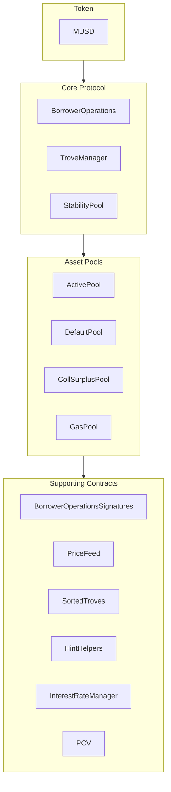

MUSD ist ein durch Bitcoin gedeckter Stablecoin, der einen stabilen Wertspeicher bietet und dabei die Sicherheit und Dezentralisierung von Bitcoin bewahrt. Dieser Leitfaden behandelt die Kernarchitektur von MUSD und die Integration mit seinen Smart Contracts. MUSD ist eine besicherte Schuldposition (Collateralized Debt Position, CDP) auf Basis von [Threshold USD](https://github.com/Threshold-USD/dev), einem Fork von [Liquity](https://github.com/liquity/dev).

## Architekturübersicht

Das Protokoll ermöglicht es Bitcoin-Inhabern, MUSD zu minten, indem sie ihre BTC als Sicherheiten (Collateral) verwenden. So erhalten Nutzer Zugang zu auf USD lautender Liquidität und behalten gleichzeitig ihr Bitcoin-Investment. Die Hauptbestandteile sind die Art, wie das System die **Verwahrung** handhabt, die **Preisbindung** aufrechterhält und **Gebühren** verdient.

### Verwahrung

Ein Nutzer eröffnet eine Position, indem er `BorrowerOperations.openTrove` aufruft, BTC bereitstellt und MUSD anfordert. Die BTC werden an den `ActivePool` geleitet, wo sie verbleiben, bis ein Nutzer entweder:

- abhebt (über `BorrowerOperations.withdrawColl`).
- seine Schulden begleicht (über `BorrowerOperations.closeTrove`).
- von einer Einlösung betroffen ist (über `TroveManager.redeemCollateral`).
- liquidiert wird (über `TroveManager.liquidate`).

Liquidierte Positionen werden entweder vom `StabilityPool` beglichen – dann werden die BTC dorthin übertragen –, oder Schulden und Sicherheiten werden übernommen und auf andere Nutzer umverteilt – dann werden die BTC an den `DefaultPool` übertragen.

### Aufrechterhaltung der Preisbindung

Wir halten die **Preisuntergrenze von \$1** durch Arbitrage, ein externes Preisorakel für USD ↔ BTC und die Möglichkeit aufrecht, MUSD im Verhältnis 1:1 gegen BTC einzulösen (über `TroveManager.redeemCollateral`). Angenommen, MUSD wird an einer Börse für `$0.80` gehandelt und Bitcoin kostet `1 BTC = $100k`. Ein Arbitrageur mit `$800` könnte:

1. `$800` gegen `1000 MUSD` tauschen.
2. `1000 MUSD` gegen `0.01 BTC` (BTC im Wert von `$1000`) einlösen.
3. `0.01 BTC` für `$1000` verkaufen.

Der Arbitrageur erzielt einen Gewinn von `$200` (ohne Gebühren). Bei diesem Handel werden MUSD **gekauft** und **verbrannt**, was Aufwärtsdruck auf den Preis erzeugt, bis dieser wieder bei `$1` liegt.

Wir halten eine **Preisobergrenze von \$1,10** über die Mindestbesicherungsquote von 110 % aufrecht. Angenommen, MUSD wird an einer Börse für `$1.20` gehandelt und Bitcoin kostet `1 BTC = $100k`. Ein Arbitrageur mit `$100k` könnte:

1. `1 BTC` kaufen (im Wert von `$100k`).
2. Einen Trove mit `1 BTC` als Sicherheit eröffnen und maximal `90,909 MUSD` leihen.
3. `90,909 MUSD` für `$109,091` verkaufen.

Der Arbitrageur erzielt einen Gewinn von `$9,091` (ohne Gebühren). Bei diesem Handel werden MUSD **verkauft** und **gemintet**, was Abwärtsdruck auf den Preis erzeugt, bis dieser `$1.10` erreicht.

### Gebühren

Das Protokoll erhebt an vier Stellen Gebühren:
- Eine Kreditgebühr von 0,1 % (per Governance anpassbar), die einem Trove als Schulden hinzugefügt, aber an die Governance gemintet wird.
- Eine Einlösungsgebühr von 0,75 % (per Governance anpassbar), die immer dann erhoben wird, wenn ein Nutzer MUSD gegen BTC einlöst.
- Eine Refinanzierungsgebühr, die wie die Kreditgebühr funktioniert.
- Einfache, feste Zinsen auf den Kreditbetrag.

## Grundkonzepte

### Bootstrap-Kredit des Protokolls und Stability Pool

Anders als bei Protokollen, die Einzahlungen in den Stability Pool mit Token-Belohnungen fördern, wird der Stability Pool von MUSD anfangs mit einem Bootstrap-Kredit befüllt. Diese MUSD können nur für Liquidationen verwendet werden. Werden die MUSD des Protokolls bei einer Liquidation eingesetzt, dienen sie zunächst dazu, einen etwaigen ausstehenden Saldo des Protokollkredits zurückzuzahlen. So wird sichergestellt, dass der Bootstrap-Kredit nicht abgehoben werden kann. Rückzahlungen auf diesen Kredit sollen voraussichtlich wöchentlich erfolgen.

### Protocol Controlled Value (PCV)

Mit der Zeit, während das Protokoll Zinsen und Gebühren einnimmt, wird der Bootstrap-Kredit zurückgezahlt, und der Anteil der MUSD im Stability Pool, der Protocol Controlled Value ist, wächst. Der PCV-Contract verwaltet die Verteilung der aus Zinsen und Gebühren angesammelten MUSD; die Aufteilung zwischen Kreditrückzahlung und einem Gebührenempfänger ist per Governance anpassbar.

### Unveränderlichkeit und Upgradefähigkeit

Die Smart Contracts von MUSD sind upgradefähig, damit Fehler behoben werden können. Wesentliche Änderungen würden das Deployment eines neuen Contract-Sets erfordern, zu dem Nutzer freiwillig migrieren – so behalten die Nutzer die Kontrolle. Sobald sich die Contracts in der Praxis bewährt haben, werden sie unveränderlich gemacht.

## Repository-Struktur

Das [MUSD-Repository](https://github.com/mezo-org/musd.git) enthält:

- **[Smart Contracts](https://github.com/mezo-org/musd/tree/main/contracts)**: zentrale Contracts des MUSD-Protokolls
- **[Integrationsbeispiele](https://github.com/mezo-org/musd/tree/main/examples)**: Beispielimplementierungen
- **[Test-Suite](https://github.com/mezo-org/musd/tree/main/test)**: umfassende Testabdeckung
- **[Dokumentation](https://github.com/mezo-org/musd/tree/main/docs)**: technische Spezifikationen

## Einrichtung der Entwicklungsumgebung

### Voraussetzungen

- Node.js 18+ (die genaue Version finden Sie in der [`.nvmrc`](https://github.com/mezo-org/musd/blob/main/.nvmrc))
- Paketmanager pnpm
- Foundry für die Smart-Contract-Entwicklung
- Git

### Installation

1.  Klonen Sie das Repository:
    ```bash
    git clone https://github.com/mezo-org/musd.git
    cd musd
    ```
2.  Installieren Sie die Abhängigkeiten:
    ```bash
    pnpm install
    ```
3.  Richten Sie die Umgebung ein:
    ```bash
    cp .env.example .env
    # Edit .env with your configuration
    ```

## Systemübersicht

Das MUSD-System besteht aus vier Haupt-Contract-Gruppen:



-   **Kernprotokoll**: Wickelt die Hauptoperationen ab, etwa das Eröffnen/Schließen von Positionen und die Verwaltung von Sicherheiten.
-   **Asset-Pools**: Verwalten die verschiedenen Sicherheiten- und Liquiditätspools des Systems.
-   **Unterstützende Contracts**: Stellen Dienste wie Preisfeeds, Remote-Trove-Verwaltung und PCV bereit.

## Integrationsleitfaden

### Einen Trove eröffnen

Für eine optimale Gaseffizienz sollten Sie Hinweise (Hints) für die Einfügeposition des Troves in der sortierten Liste angeben.

```typescript
async function openTroveWithHints(
  contracts: {
    borrowerOperations: Contract,
    troveManager: Contract,
    sortedTroves: Contract,
    hintHelpers: Contract
  },
  wallet: Wallet,
  debtAmount: bigint,
  assetAmount: bigint
) {
  // Compute expected total debt by adding gas compensation and fee
  const gasCompensation = await contracts.troveManager.MUSD_GAS_COMPENSATION();
  const expectedFee = 
    await contracts.borrowerOperations.getBorrowingFee(debtAmount);
  const expectedTotalDebt = debtAmount + expectedFee + gasCompensation;

  const nicr = (assetAmount * BigInt(1e20)) / expectedTotalDebt;

  const { '0': approxHint } = await contracts.hintHelpers.getApproxHint(nicr, 15, 42);

  const { '0': upperHint, '1': lowerHint } =
    await contracts.sortedTroves.findInsertPosition(nicr, approxHint, approxHint);

  await contracts.borrowerOperations
    .connect(wallet)
    .openTrove(debtAmount, upperHint, lowerHint, { value: assetAmount });
}
```

### Troves anpassen und schließen

Auf ähnliche Weise können Sie Troves anpassen (`adjustTrove`) oder schließen (`closeTrove`). Außerdem gibt es Komfortfunktionen zum Abheben/Zurückzahlen von MUSD und zum Hinzufügen/Abheben von Sicherheiten. Vollständige Beispiele finden Sie in der [Demo-Testdatei](https://github.com/mezo-org/musd/blob/main/test/integration/Demo.test.ts).

## Liquidationen

Fällt die Besicherungsquote eines Troves unter 110 %, kann er von jedem liquidiert werden. Der Liquidator wird mit einer Gas-Entschädigung und einem prozentualen Anteil an den Sicherheiten des Troves belohnt.

### Abläufe bei Liquidationen

1.  **Mit Stability Pool**: Die MUSD des Stability Pool werden verbrannt, um die Schulden zu decken, und der Pool übernimmt die Sicherheiten.
2.  **Teilweise über den Stability Pool**: Reicht der Pool nicht aus, deckt er so viel wie möglich ab, und die restlichen Schulden/Sicherheiten werden auf andere aktive Troves umverteilt.
3.  **Leerer Stability Pool**: Alle Schulden und Sicherheiten werden auf andere aktive Troves umverteilt.

### Eine Liquidation ausführen

```typescript
async function liquidateTrove(
  troveManager: Contract,
  wallet: Wallet,
  borrowerAddress: string
) {
  await troveManager.connect(wallet).liquidate(borrowerAddress);
}

async function batchLiquidate(
  troveManager: Contract,
  wallet: Wallet,
  troveAddresses: string[]
) {
  await troveManager.connect(wallet).batchLiquidateTroves(troveAddresses);
}
```

## Einlösungen

Jeder MUSD-Inhaber kann seine Token gegen BTC im entsprechenden Wert einlösen, was zur Aufrechterhaltung der Bindung an `$1` beiträgt. Das System löst gegen den Trove mit der niedrigsten Besicherungsquote ein.

Eine Schritt-für-Schritt-Anleitung und Code finden Sie im entsprechenden Leitfaden:

- [MUSD-Einlösungen](/docs/de/docs/developers/musd/musd-redemptions/)

## Risiken für Kreditnehmer

-   **Liquidationsrisiko**: Ihre Sicherheiten können liquidiert werden, wenn ihr Wert unter 110 % Ihrer Schulden fällt.
-   **Einlösungsrisiko**: Ihre Sicherheiten können zur Aufrechterhaltung der Bindung eingelöst werden, was ein steuerpflichtiges Ereignis auslöst und Sie das Aufwärtspotenzial kostet.
-   **Uneinbringliche Schulden (Bad Debt)**: In Extremfällen könnten uneinbringliche Schulden auf andere Kreditnehmer umgelegt werden.

## Tests

```bash
# Run all tests
pnpm test

# Run with gas reporting
pnpm test:gas

# Run with coverage
pnpm coverage
```

## Wichtige Änderungen gegenüber THUSD

-   **Kreditaufnahme mit festem Zinssatz**: Zinssätze werden bei Eröffnung eines Troves festgelegt und können refinanziert werden.
-   **Protocol Controlled Value (PCV)**: Verwaltet Gebühren für die Kreditrückzahlung und andere Anforderungen des Systems.
-   **Signaturprüfung nach EIP-712**: Ermöglicht gaslose Transaktionsautorisierungen.
-   **Keine speziellen Liquidationen im Recovery Mode**: Liquidationen folgen einem einheitlichen Ablauf.

## Definitionen

-   **Trove**: Eine besicherte Schuldposition (CDP).
-   **ICR**: Individuelle Besicherungsquote (Individual Collateralization Ratio) eines einzelnen Troves.
-   **TCR**: Gesamtbesicherungsquote (Total Collateralization Ratio) des gesamten Systems.
-   **Recovery Mode (Wiederherstellungsmodus)**: Wird aktiviert, wenn die TCR unter 150 % fällt, und setzt strengere Regeln für die Kreditaufnahme durch.

## Weitere Ressourcen

-   **[MUSD-Haupt-README](https://github.com/mezo-org/musd/blob/main/README.md)** – umfassende Architekturübersicht.
-   **[Demo-Test-Suite](https://github.com/mezo-org/musd/blob/main/test/integration/Demo.test.ts)** – funktionierende Codebeispiele.
-   **[MUSD-Leitfaden für Nutzer](/docs/de/docs/users/borrow/)** – Dokumentation für Endnutzer.
