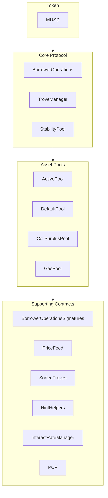

MUSD es una stablecoin respaldada por Bitcoin que ofrece una reserva de valor estable a la vez que conserva la seguridad y la descentralización de Bitcoin. Esta guía abarca la arquitectura central de MUSD y cómo integrarte con sus contratos inteligentes. MUSD es una posición de deuda colateralizada (CDP) basada en [Threshold USD](https://github.com/Threshold-USD/dev), que es un fork de [Liquity](https://github.com/liquity/dev).

## Descripción general de la arquitectura

El protocolo permite a los titulares de Bitcoin acuñar MUSD usando su BTC como colateral. Esto significa que los usuarios pueden acceder a liquidez denominada en USD manteniendo intacta su inversión en Bitcoin. Los componentes principales son cómo el sistema gestiona la **custodia**, cómo mantiene la **paridad de precio** y cómo obtiene **comisiones**.

### Custodia

Un usuario abre una posición llamando a `BorrowerOperations.openTrove`, aportando BTC y solicitando MUSD. El BTC se dirige al `ActivePool`, donde permanece hasta que el usuario:

- lo retira (mediante `BorrowerOperations.withdrawColl`).
- salda su deuda (mediante `BorrowerOperations.closeTrove`).
- es objeto de una redención (mediante `TroveManager.redeemCollateral`).
- es liquidado (mediante `TroveManager.liquidate`).

Las posiciones liquidadas las paga el `StabilityPool`, en cuyo caso el BTC se transfiere allí, o bien la deuda y el colateral se absorben y se redistribuyen entre otros usuarios, en cuyo caso el BTC se transfiere al `DefaultPool`.

### Mantener la paridad

Mantenemos el **precio mínimo de \$1** mediante arbitraje, un oráculo externo de precios USD ↔ BTC y la posibilidad de redimir MUSD por BTC a una tasa de 1:1 (mediante `TroveManager.redeemCollateral`). Imagina que MUSD cotiza a `$0.80` en un exchange y que bitcoin se vende a `1 BTC = $100k`. Un arbitrajista con `$800` podría:

1. Cambiar `$800` por `1000 MUSD`.
2. Redimir `1000 MUSD` por `0.01 BTC` (`$1000` en BTC).
3. Vender `0.01 BTC` por `$1000`.

El arbitrajista obtiene una ganancia de `$200` (sin contar las comisiones). Esta operación **compra** MUSD y lo **quema**, lo que genera una presión alcista sobre el precio hasta que este vuelve a `$1`.

Mantenemos un **precio máximo de \$1.10** mediante el ratio de colateralización mínimo del 110%. Imagina que MUSD cotiza a `$1.20` en un exchange y que bitcoin se vende a `1 BTC = $100k`. Un arbitrajista con `$100k` podría:

1. Comprar `1 BTC` (con un valor de `$100k`).
2. Abrir un trove con `1 BTC` como colateral y pedir prestado el máximo de `90,909 MUSD`.
3. Vender `90,909 MUSD` por `$109,091`.

El arbitrajista obtiene una ganancia de `$9,091` (sin contar las comisiones). Esta operación **vende** y **acuña** MUSD, lo que genera una presión bajista sobre el precio hasta que este llega a `$1.10`.

### Comisiones

El protocolo cobra comisiones en cuatro puntos:
- Una tasa de préstamo del 0.1% (ajustable por gobernanza), que se añade como deuda a un trove pero se acuña para la gobernanza.
- Una tasa de redención del 0.75% (ajustable por gobernanza), que se cobra cada vez que un usuario redime MUSD por BTC.
- Una tasa de refinanciación, que funciona igual que la tasa de préstamo.
- Un interés simple y fijo sobre el principal del préstamo.

## Ideas principales

### Préstamo de arranque del protocolo y Stability Pool

A diferencia de los protocolos que incentivan los depósitos en el stability pool con recompensas en tokens, el Stability Pool de MUSD se nutre inicialmente con un préstamo de arranque. Este MUSD solo se puede usar para liquidaciones. Cuando el MUSD del protocolo se usa en una liquidación, primero se destina a reembolsar el saldo pendiente del préstamo del protocolo, lo que garantiza que el préstamo de arranque no se pueda retirar. Se prevé que los reembolsos de este préstamo se realicen semanalmente.

### Protocol Controlled Value (PCV)

Con el tiempo, a medida que el protocolo acumula intereses y comisiones, el préstamo de arranque se va reembolsando y aumenta la parte del MUSD del Stability Pool que corresponde a Protocol Controlled Value. El contrato PCV gestiona la distribución del MUSD acumulado procedente de intereses y comisiones, y el reparto entre el reembolso del préstamo y un destinatario de comisiones es ajustable por gobernanza.

### Inmutabilidad y capacidad de actualización

Los contratos inteligentes de MUSD son actualizables para permitir correcciones. Los cambios sustanciales requerirían desplegar un nuevo conjunto de contratos y que los usuarios aceptaran migrar de forma voluntaria, lo que garantiza el control por parte del usuario. Una vez que hayan demostrado su solidez en producción, los contratos se volverán inmutables.

## Estructura del repositorio

El [repositorio de MUSD](https://github.com/mezo-org/musd.git) contiene:

- **[Contratos inteligentes](https://github.com/mezo-org/musd/tree/main/contracts)**: contratos principales del protocolo MUSD
- **[Ejemplos de integración](https://github.com/mezo-org/musd/tree/main/examples)**: implementaciones de ejemplo
- **[Suite de pruebas](https://github.com/mezo-org/musd/tree/main/test)**: cobertura de pruebas exhaustiva
- **[Documentación](https://github.com/mezo-org/musd/tree/main/docs)**: especificaciones técnicas

## Configuración del entorno de desarrollo

### Requisitos previos

- Node.js 18+ (consulta [`.nvmrc`](https://github.com/mezo-org/musd/blob/main/.nvmrc) para ver la versión exacta)
- Gestor de paquetes pnpm
- Foundry para el desarrollo de contratos inteligentes
- Git

### Instalación

1.  Clona el repositorio:
    ```bash
    git clone https://github.com/mezo-org/musd.git
    cd musd
    ```
2.  Instala las dependencias:
    ```bash
    pnpm install
    ```
3.  Configura el entorno:
    ```bash
    cp .env.example .env
    # Edit .env with your configuration
    ```

## Descripción general del sistema

El sistema MUSD consta de cuatro grupos principales de contratos:



-   **Core Protocol** (protocolo principal): gestiona las operaciones principales, como abrir/cerrar posiciones y gestionar el colateral.
-   **Asset Pools** (pools de activos): gestiona los distintos pools de colateral y de liquidez del sistema.
-   **Supporting Contracts** (contratos de soporte): proporciona servicios como feeds de precios, gestión remota de troves y PCV.

## Guía de integración

### Abrir un trove

Para optimizar el consumo de gas, proporciona hints sobre la posición de inserción del trove en la lista ordenada.

```typescript
async function openTroveWithHints(
  contracts: {
    borrowerOperations: Contract,
    troveManager: Contract,
    sortedTroves: Contract,
    hintHelpers: Contract
  },
  wallet: Wallet,
  debtAmount: bigint,
  assetAmount: bigint
) {
  // Compute expected total debt by adding gas compensation and fee
  const gasCompensation = await contracts.troveManager.MUSD_GAS_COMPENSATION();
  const expectedFee = 
    await contracts.borrowerOperations.getBorrowingFee(debtAmount);
  const expectedTotalDebt = debtAmount + expectedFee + gasCompensation;

  const nicr = (assetAmount * BigInt(1e20)) / expectedTotalDebt;

  const { '0': approxHint } = await contracts.hintHelpers.getApproxHint(nicr, 15, 42);

  const { '0': upperHint, '1': lowerHint } =
    await contracts.sortedTroves.findInsertPosition(nicr, approxHint, approxHint);

  await contracts.borrowerOperations
    .connect(wallet)
    .openTrove(debtAmount, upperHint, lowerHint, { value: assetAmount });
}
```

### Ajustar y cerrar troves

De forma similar, puedes ajustar (`adjustTrove`) o cerrar (`closeTrove`) troves. También hay funciones de conveniencia para retirar/reembolsar MUSD y para agregar/retirar colateral. Para ver ejemplos completos, consulta el [archivo de pruebas de demostración](https://github.com/mezo-org/musd/blob/main/test/integration/Demo.test.ts).

## Liquidaciones

Cuando el ratio de colateralización de un trove cae por debajo del 110%, cualquiera puede liquidarlo. El liquidador recibe como recompensa una compensación de gas y un porcentaje del colateral del trove.

### Flujos de liquidación

1.  **Con Stability Pool**: el MUSD del Stability Pool se quema para cubrir la deuda, y el pool se queda con el colateral.
2.  **Stability Pool parcial**: si el pool no es suficiente, cubre lo que puede, y la deuda/el colateral restantes se redistribuyen entre otros troves activos.
3.  **Stability Pool vacío**: toda la deuda y todo el colateral se redistribuyen entre otros troves activos.

### Ejecutar una liquidación

```typescript
async function liquidateTrove(
  troveManager: Contract,
  wallet: Wallet,
  borrowerAddress: string
) {
  await troveManager.connect(wallet).liquidate(borrowerAddress);
}

async function batchLiquidate(
  troveManager: Contract,
  wallet: Wallet,
  troveAddresses: string[]
) {
  await troveManager.connect(wallet).batchLiquidateTroves(troveAddresses);
}
```

## Redenciones

Cualquier titular de MUSD puede redimir sus tokens por un valor equivalente en BTC, lo que ayuda a mantener la paridad de `$1`. El sistema realiza la redención contra el trove con el ratio de colateralización más bajo.

Para ver instrucciones paso a paso y código, consulta la guía específica:

- [Redenciones de MUSD](/docs/es/docs/developers/musd/musd-redemptions/)

## Riesgos para los prestatarios

-   **Riesgo de liquidación**: tu colateral puede liquidarse si su valor cae por debajo del 110% de tu deuda.
-   **Riesgo de redención**: tu colateral puede redimirse para mantener la paridad, lo que genera un hecho imponible y la pérdida de exposición al alza.
-   **Deuda incobrable**: en casos extremos, la deuda incobrable podría socializarse entre los demás prestatarios.

## Pruebas

```bash
# Run all tests
pnpm test

# Run with gas reporting
pnpm test:gas

# Run with coverage
pnpm coverage
```

## Cambios clave respecto a THUSD

-   **Préstamos con interés fijo**: las tasas de interés se fijan al abrir un trove y se pueden refinanciar.
-   **Protocol Controlled Value (PCV)**: gestiona las comisiones para el reembolso del préstamo y otras necesidades del sistema.
-   **Verificación de firmas EIP-712**: permite autorizar transacciones sin gas.
-   **Sin liquidaciones especiales en Recovery Mode**: las liquidaciones siguen un único proceso.

## Definiciones

-   **Trove**: una posición de deuda colateralizada (CDP).
-   **ICR**: ratio de colateralización individual (Individual Collateralization Ratio) de un único trove.
-   **TCR**: ratio de colateralización total (Total Collateralization Ratio) de todo el sistema.
-   **Recovery Mode**: se activa si el TCR cae por debajo del 150% y aplica reglas de préstamo más estrictas.

## Recursos adicionales

-   **[README principal de MUSD](https://github.com/mezo-org/musd/blob/main/README.md)**: descripción general completa de la arquitectura.
-   **[Suite de pruebas de demostración](https://github.com/mezo-org/musd/blob/main/test/integration/Demo.test.ts)**: ejemplos de código funcionales.
-   **[Guía de usuario de MUSD](/docs/es/docs/users/borrow/)**: documentación para usuarios finales.
