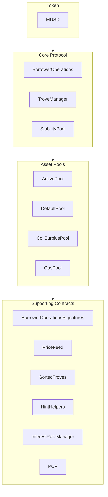

MUSD est un stablecoin adossé à Bitcoin qui offre une réserve de valeur stable tout en conservant la sécurité et la décentralisation de Bitcoin. Ce guide présente l'architecture fondamentale de MUSD et explique comment s'intégrer à ses contrats intelligents. MUSD est une position de dette garantie (CDP) basée sur [Threshold USD](https://github.com/Threshold-USD/dev), lui-même un fork de [Liquity](https://github.com/liquity/dev).

## Aperçu de l'architecture

Le protocole permet aux détenteurs de Bitcoin de frapper des MUSD en utilisant leurs BTC comme garantie. Les utilisateurs peuvent ainsi accéder à une liquidité libellée en USD tout en conservant leur investissement en Bitcoin. Les principaux éléments sont la manière dont le système gère la **conservation**, maintient l'**ancrage du prix** et perçoit des **frais**.

### Conservation

Un utilisateur ouvre une position en appelant `BorrowerOperations.openTrove`, en fournissant des BTC et en demandant des MUSD. Les BTC sont acheminés vers l'`ActivePool`, où ils restent jusqu'à ce que l'utilisateur :

- effectue un retrait (via `BorrowerOperations.withdrawColl`) ;
- rembourse sa dette (via `BorrowerOperations.closeTrove`) ;
- fasse l'objet d'un rachat (via `TroveManager.redeemCollateral`) ;
- soit liquidé (via `TroveManager.liquidate`).

Les positions liquidées sont soit couvertes par le `StabilityPool`, auquel cas les BTC y sont transférés, soit leur dette et leur garantie sont absorbées et redistribuées aux autres utilisateurs, auquel cas les BTC sont transférés vers le `DefaultPool`.

### Maintien de l'ancrage

Nous maintenons un **prix plancher de 1 \$** grâce à l'arbitrage, à un oracle de prix externe USD ↔ BTC et à la possibilité de racheter des MUSD contre des BTC à un taux de 1:1 (via `TroveManager.redeemCollateral`). Imaginons que le MUSD s'échange à `$0.80` sur une plateforme d'échange et que le bitcoin se vende à `1 BTC = $100k`. Un arbitragiste disposant de `$800` pourrait :

1. Échanger `$800` contre `1000 MUSD`.
2. Racheter `1000 MUSD` contre `0.01 BTC` (soit `$1000` de BTC).
3. Vendre `0.01 BTC` pour `$1000`.

L'arbitragiste réalise un bénéfice de `$200` (hors frais). Cette opération **achète** des MUSD et les **brûle**, ce qui exerce une pression à la hausse sur le prix jusqu'à ce qu'il revienne à `$1`.

Nous maintenons un **prix plafond de 1,10 \$** grâce au ratio de collatéralisation minimum de 110 %. Imaginons que le MUSD s'échange à `$1.20` sur une plateforme d'échange et que le bitcoin se vende à `1 BTC = $100k`. Un arbitragiste disposant de `$100k` pourrait :

1. Acheter `1 BTC` (d'une valeur de `$100k`).
2. Ouvrir un trove avec `1 BTC` en garantie et emprunter le maximum, soit `90,909 MUSD`.
3. Vendre `90,909 MUSD` pour `$109,091`.

L'arbitragiste réalise un bénéfice de `$9,091` (hors frais). Cette opération **vend** et **frappe** des MUSD, ce qui exerce une pression à la baisse sur le prix jusqu'à ce qu'il atteigne `$1.10`.

### Frais

Le protocole perçoit des frais à quatre niveaux :
- Un taux d'emprunt de 0,1 % (modifiable par la gouvernance), ajouté à la dette du trove mais frappé au profit de la gouvernance.
- Un taux de rachat de 0,75 % (modifiable par la gouvernance), prélevé chaque fois qu'un utilisateur rachète des MUSD contre des BTC.
- Un taux de refinancement, qui fonctionne comme le taux d'emprunt.
- Des intérêts simples et fixes sur le principal du prêt.

## Idées fondamentales

### Prêt d'amorçage du protocole et Stability Pool

Contrairement aux protocoles qui encouragent les dépôts dans le stability pool par des récompenses en jetons, le Stability Pool de MUSD est initialement alimenté par un prêt d'amorçage. Ces MUSD ne peuvent servir qu'aux liquidations. Lorsque les MUSD du protocole sont utilisés dans une liquidation, ils servent d'abord à rembourser le solde restant dû du prêt du protocole, ce qui garantit que le prêt d'amorçage ne peut pas être retiré. Les remboursements de ce prêt sont prévus sur une base hebdomadaire.

### Protocol Controlled Value (PCV)

Au fil du temps, à mesure que le protocole accumule des intérêts et des frais, le prêt d'amorçage est remboursé et la part des MUSD du Stability Pool qui constitue la Protocol Controlled Value augmente. Le contrat PCV gère la distribution des MUSD accumulés grâce aux intérêts et aux frais, la répartition entre le remboursement du prêt et un destinataire des frais étant modifiable par la gouvernance.

### Immutabilité et évolutivité

Les contrats intelligents MUSD sont évolutifs (upgradables) afin de permettre des correctifs. Des changements substantiels nécessiteraient de déployer un nouvel ensemble de contrats et de laisser les utilisateurs choisir de migrer, ce qui garantit leur contrôle. Une fois éprouvés en conditions réelles, les contrats seront rendus immuables.

## Structure du dépôt

Le [dépôt MUSD](https://github.com/mezo-org/musd.git) contient :

- **[Contrats intelligents](https://github.com/mezo-org/musd/tree/main/contracts)** : contrats principaux du protocole MUSD
- **[Exemples d'intégration](https://github.com/mezo-org/musd/tree/main/examples)** : exemples d'implémentation
- **[Suite de tests](https://github.com/mezo-org/musd/tree/main/test)** : couverture de tests complète
- **[Documentation](https://github.com/mezo-org/musd/tree/main/docs)** : spécifications techniques

## Configuration de l'environnement de développement

### Prérequis

- Node.js 18+ (consultez [`.nvmrc`](https://github.com/mezo-org/musd/blob/main/.nvmrc) pour la version exacte)
- Gestionnaire de paquets pnpm
- Foundry pour le développement de contrats intelligents
- Git

### Installation

1.  Clonez le dépôt :
    ```bash
    git clone https://github.com/mezo-org/musd.git
    cd musd
    ```
2.  Installez les dépendances :
    ```bash
    pnpm install
    ```
3.  Configurez l'environnement :
    ```bash
    cp .env.example .env
    # Edit .env with your configuration
    ```

## Aperçu du système

Le système MUSD se compose de quatre grands groupes de contrats :



-   **Protocole central** : gère les opérations principales, comme l'ouverture et la clôture des positions et la gestion de la garantie.
-   **Pools d'actifs** : gèrent les différents pools de garantie et de liquidité du système.
-   **Contrats de support** : fournissent des services comme les flux de prix, la gestion de troves à distance et la PCV.

## Guide d'intégration

### Ouvrir un trove

Pour optimiser la consommation de gaz, fournissez des hints (indications) sur la position d'insertion du trove dans la liste triée.

```typescript
async function openTroveWithHints(
  contracts: {
    borrowerOperations: Contract,
    troveManager: Contract,
    sortedTroves: Contract,
    hintHelpers: Contract
  },
  wallet: Wallet,
  debtAmount: bigint,
  assetAmount: bigint
) {
  // Compute expected total debt by adding gas compensation and fee
  const gasCompensation = await contracts.troveManager.MUSD_GAS_COMPENSATION();
  const expectedFee = 
    await contracts.borrowerOperations.getBorrowingFee(debtAmount);
  const expectedTotalDebt = debtAmount + expectedFee + gasCompensation;

  const nicr = (assetAmount * BigInt(1e20)) / expectedTotalDebt;

  const { '0': approxHint } = await contracts.hintHelpers.getApproxHint(nicr, 15, 42);

  const { '0': upperHint, '1': lowerHint } =
    await contracts.sortedTroves.findInsertPosition(nicr, approxHint, approxHint);

  await contracts.borrowerOperations
    .connect(wallet)
    .openTrove(debtAmount, upperHint, lowerHint, { value: assetAmount });
}
```

### Ajuster et fermer des troves

Vous pouvez de la même manière ajuster (`adjustTrove`) ou fermer (`closeTrove`) des troves. Des fonctions pratiques sont également disponibles pour retirer/rembourser des MUSD et ajouter/retirer de la garantie. Pour des exemples complets, consultez le [fichier de test de démonstration](https://github.com/mezo-org/musd/blob/main/test/integration/Demo.test.ts).

## Liquidations

Lorsque le ratio de collatéralisation d'un trove passe sous 110 %, n'importe qui peut le liquider. Le liquidateur est récompensé par une compensation de gaz et un pourcentage de la garantie du trove.

### Flux de liquidation

1.  **Avec le Stability Pool** : les MUSD du Stability Pool sont brûlés pour couvrir la dette, et le pool récupère la garantie.
2.  **Stability Pool partiel** : si le pool est insuffisant, il couvre ce qu'il peut, et la dette/garantie restante est redistribuée aux autres troves actifs.
3.  **Stability Pool vide** : l'intégralité de la dette et de la garantie est redistribuée aux autres troves actifs.

### Exécuter une liquidation

```typescript
async function liquidateTrove(
  troveManager: Contract,
  wallet: Wallet,
  borrowerAddress: string
) {
  await troveManager.connect(wallet).liquidate(borrowerAddress);
}

async function batchLiquidate(
  troveManager: Contract,
  wallet: Wallet,
  troveAddresses: string[]
) {
  await troveManager.connect(wallet).batchLiquidateTroves(troveAddresses);
}
```

## Rachats

Tout détenteur de MUSD peut racheter ses jetons contre une valeur équivalente en BTC, ce qui contribue à maintenir l'ancrage à `$1`. Le système effectue le rachat sur le trove dont le ratio de garantie est le plus bas.

Pour des instructions détaillées et du code, consultez le guide dédié :

- [Rachats de MUSD](/docs/fr/docs/developers/musd/musd-redemptions/)

## Risques pour les emprunteurs

-   **Risque de liquidation** : votre garantie peut être liquidée si sa valeur passe sous 110 % de votre dette.
-   **Risque de rachat** : votre garantie peut être rachetée pour maintenir l'ancrage, ce qui entraîne un événement imposable et la perte de l'exposition à la hausse.
-   **Créances irrécouvrables** : dans des cas extrêmes, les créances irrécouvrables (bad debt) pourraient être mutualisées entre les autres emprunteurs.

## Tests

```bash
# Run all tests
pnpm test

# Run with gas reporting
pnpm test:gas

# Run with coverage
pnpm coverage
```

## Principales différences par rapport à THUSD

-   **Emprunt à taux fixe** : les taux d'intérêt sont fixés à l'ouverture d'un trove et peuvent être refinancés.
-   **Protocol Controlled Value (PCV)** : gère les frais destinés au remboursement du prêt et aux autres besoins du système.
-   **Vérification de signatures EIP-712** : permet des autorisations de transactions sans gaz (gasless).
-   **Aucune liquidation spécifique au Recovery Mode** : les liquidations suivent un processus unique.

## Définitions

-   **Trove** : une position de dette garantie (CDP).
-   **ICR** : ratio de collatéralisation individuel (Individual Collateralization Ratio) d'un trove.
-   **TCR** : ratio de collatéralisation total (Total Collateralization Ratio) de l'ensemble du système.
-   **Recovery Mode** : mode activé si le TCR passe sous 150 %, qui impose des règles d'emprunt plus strictes.

## Ressources supplémentaires

-   **[README principal de MUSD](https://github.com/mezo-org/musd/blob/main/README.md)** – aperçu complet de l'architecture.
-   **[Suite de tests de démonstration](https://github.com/mezo-org/musd/blob/main/test/integration/Demo.test.ts)** – exemples de code fonctionnels.
-   **[Guide utilisateur MUSD](/docs/fr/docs/users/borrow/)** – documentation destinée aux utilisateurs finaux.
