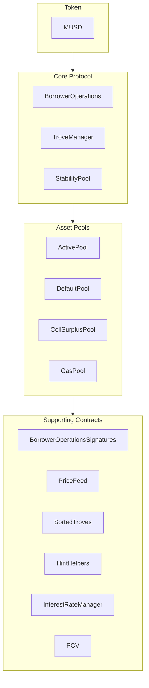

MUSD एक बिटकॉइन-समर्थित स्टेबलकॉइन है, जो बिटकॉइन की सुरक्षा और डिसेंट्रलाइज़ेशन को बनाए रखते हुए वैल्यू को स्थिर रूप से रखने का ज़रिया देता है। यह गाइड MUSD के मुख्य आर्किटेक्चर और उसके स्मार्ट कॉन्ट्रैक्ट्स के साथ इंटीग्रेट करने का तरीका बताती है। MUSD एक कोलैटरलाइज़्ड डेट पोज़िशन (CDP) है, जो [Threshold USD](https://github.com/Threshold-USD/dev) पर आधारित है, जो खुद [Liquity](https://github.com/liquity/dev) का एक फ़ोर्क है।

## आर्किटेक्चर का अवलोकन

यह प्रोटोकॉल बिटकॉइन होल्डर्स को अपने BTC को कोलैटरल के रूप में इस्तेमाल करके MUSD मिंट करने देता है। इसका मतलब है कि यूज़र अपने बिटकॉइन निवेश को बनाए रखते हुए USD-मूल्य वाली लिक्विडिटी पा सकते हैं। मुख्य हिस्से ये हैं कि सिस्टम **कस्टडी** को कैसे संभालता है, **प्राइस पेग** को कैसे बनाए रखता है, और **फीस** कैसे कमाता है।

### कस्टडी

यूज़र `BorrowerOperations.openTrove` कॉल करके, BTC देकर और MUSD का अनुरोध करके एक पोज़िशन खोलता है। BTC को `ActivePool` में भेजा जाता है, जहां वह तब तक रहता है जब तक यूज़र:

- उसे निकाल नहीं लेता (`BorrowerOperations.withdrawColl` के ज़रिए)।
- अपना कर्ज़ चुका नहीं देता (`BorrowerOperations.closeTrove` के ज़रिए)।
- उसके ख़िलाफ़ रिडेम्पशन नहीं हो जाता (`TroveManager.redeemCollateral` के ज़रिए)।
- लिक्विडेट नहीं हो जाता (`TroveManager.liquidate` के ज़रिए)।

लिक्विडेट हुई पोज़िशन का भुगतान या तो `StabilityPool` करता है, जिस स्थिति में BTC वहां ट्रांसफ़र हो जाता है, या फिर कर्ज़ और कोलैटरल को सोखकर दूसरे यूज़र्स में दोबारा बांट दिया जाता है, जिस स्थिति में BTC `DefaultPool` में ट्रांसफ़र होता है।

### पेग बनाए रखना

हम आर्बिट्राज, एक बाहरी USD ↔ BTC प्राइस ऑरेकल, और MUSD को 1:1 दर पर BTC के बदले रिडीम करने की सुविधा (`TroveManager.redeemCollateral` के ज़रिए) से **\$1 का प्राइस फ़्लोर** बनाए रखते हैं। मान लीजिए कि किसी एक्सचेंज पर MUSD `$0.80` पर ट्रेड हो रहा है और बिटकॉइन `1 BTC = $100k` पर बिक रहा है। `$800` वाला एक आर्बिट्राजर यह कर सकता है:

1. `$800` के बदले `1000 MUSD` लेना।
2. `1000 MUSD` को `0.01 BTC` (`$1000` मूल्य के BTC) के बदले रिडीम करना।
3. `0.01 BTC` को `$1000` में बेचना।

आर्बिट्राजर को `$200` का मुनाफ़ा होता है (फीस को छोड़कर)। यह ट्रेड MUSD को **खरीदता** है और उसे **बर्न** करता है, जिससे कीमत पर ऊपर की ओर दबाव बनता है, जब तक कीमत फिर से `$1` पर न आ जाए।

हम न्यूनतम 110% कोलैटरलाइज़ेशन रेशियो के ज़रिए **\$1.10 की प्राइस सीलिंग** बनाए रखते हैं। मान लीजिए कि किसी एक्सचेंज पर MUSD `$1.20` पर ट्रेड हो रहा है, और बिटकॉइन `1 BTC = $100k` पर बिक रहा है। `$100k` वाला एक आर्बिट्राजर यह कर सकता है:

1. `1 BTC` (`$100k` मूल्य का) खरीदना।
2. `1 BTC` को कोलैटरल बनाकर एक trove खोलना और अधिकतम `90,909 MUSD` उधार लेना।
3. `90,909 MUSD` को `$109,091` में बेचना।

आर्बिट्राजर को `$9,091` का मुनाफ़ा होता है (फीस को छोड़कर)। यह ट्रेड MUSD को **बेचता** है और **मिंट** करता है, जिससे कीमत पर नीचे की ओर दबाव बनता है, जब तक कीमत `$1.10` तक न पहुंच जाए।

### फीस

प्रोटोकॉल चार जगहों पर फीस लेता है:
- 0.1% (गवर्नेंस से बदली जा सकने वाली) की उधार दर (borrowing rate), जो trove में कर्ज़ के रूप में जोड़ी जाती है, लेकिन गवर्नेंस को मिंट की जाती है।
- 0.75% (गवर्नेंस से बदली जा सकने वाली) की रिडेम्पशन रेट, जो हर बार तब ली जाती है जब कोई यूज़र MUSD को BTC के बदले रिडीम करता है।
- एक रीफ़ाइनेंसिंग रेट, जो उधार दर की तरह ही काम करती है।
- लोन के मूलधन पर साधारण, निश्चित ब्याज।

## मुख्य विचार

### प्रोटोकॉल बूटस्ट्रैप लोन और Stability Pool

उन प्रोटोकॉल के विपरीत जो Stability Pool डिपॉज़िट के लिए टोकन रिवॉर्ड के रूप में इंसेंटिव देते हैं, MUSD का Stability Pool शुरुआत में एक बूटस्ट्रैपिंग लोन से भरा जाता है। इस MUSD का इस्तेमाल सिर्फ़ लिक्विडेशन के लिए किया जा सकता है। जब प्रोटोकॉल का MUSD किसी लिक्विडेशन में इस्तेमाल होता है, तो सबसे पहले उससे प्रोटोकॉल लोन का कोई भी बकाया बैलेंस चुकाया जाता है, जिससे यह पक्का होता है कि बूटस्ट्रैप लोन निकाला नहीं जा सकता। इस लोन का भुगतान हर हफ़्ते किए जाने की उम्मीद है।

### Protocol Controlled Value (PCV)

समय के साथ, जैसे-जैसे प्रोटोकॉल ब्याज और फीस जमा करता है, बूटस्ट्रैप लोन चुकता होता जाता है, और Stability Pool में मौजूद MUSD का वह हिस्सा, जो Protocol Controlled Value है, बढ़ता जाता है। PCV कॉन्ट्रैक्ट ब्याज और फीस से जमा हुए MUSD के वितरण को मैनेज करता है, और लोन भुगतान व फीस प्राप्तकर्ता के बीच का बंटवारा गवर्नेंस से तय किया जा सकता है।

### इम्यूटेबिलिटी और अपग्रेडेबिलिटी

MUSD स्मार्ट कॉन्ट्रैक्ट अपग्रेड किए जा सकते हैं, ताकि फ़िक्स किए जा सकें। बड़े बदलावों के लिए कॉन्ट्रैक्ट्स का एक नया सेट डिप्लॉय करना होगा और यूज़र्स को माइग्रेट करने के लिए खुद ऑप्ट-इन करना होगा, जिससे नियंत्रण यूज़र के हाथ में रहता है। अच्छी तरह परखे जाने (battle-tested) के बाद, कॉन्ट्रैक्ट्स को इम्यूटेबल बना दिया जाएगा।

## रिपॉज़िटरी की संरचना

[MUSD रिपॉज़िटरी](https://github.com/mezo-org/musd.git) में ये शामिल हैं:

- **[स्मार्ट कॉन्ट्रैक्ट](https://github.com/mezo-org/musd/tree/main/contracts)**: मुख्य MUSD प्रोटोकॉल कॉन्ट्रैक्ट
- **[इंटीग्रेशन के उदाहरण](https://github.com/mezo-org/musd/tree/main/examples)**: सैंपल इम्प्लीमेंटेशन
- **[टेस्टिंग सुइट](https://github.com/mezo-org/musd/tree/main/test)**: व्यापक टेस्ट कवरेज
- **[दस्तावेज़ीकरण](https://github.com/mezo-org/musd/tree/main/docs)**: तकनीकी स्पेसिफ़िकेशन

## डेवलपमेंट सेटअप

### पूर्व-आवश्यकताएं

- Node.js 18+ (सटीक वर्ज़न के लिए [`.nvmrc`](https://github.com/mezo-org/musd/blob/main/.nvmrc) देखें)
- pnpm पैकेज मैनेजर
- स्मार्ट कॉन्ट्रैक्ट डेवलपमेंट के लिए Foundry
- Git

### इंस्टॉलेशन

1.  रिपॉज़िटरी क्लोन करें:
    ```bash
    git clone https://github.com/mezo-org/musd.git
    cd musd
    ```
2.  डिपेंडेंसी इंस्टॉल करें:
    ```bash
    pnpm install
    ```
3.  एनवायरनमेंट सेट अप करें:
    ```bash
    cp .env.example .env
    # Edit .env with your configuration
    ```

## सिस्टम का अवलोकन

MUSD सिस्टम में चार मुख्य कॉन्ट्रैक्ट समूह हैं:



-   **कोर प्रोटोकॉल**: पोज़िशन खोलने/बंद करने और कोलैटरल मैनेज करने जैसे मुख्य ऑपरेशन संभालता है।
-   **एसेट पूल**: सिस्टम के अलग-अलग कोलैटरल और लिक्विडिटी पूल को मैनेज करता है।
-   **सपोर्टिंग कॉन्ट्रैक्ट**: प्राइस फ़ीड, रिमोट trove मैनेजमेंट और PCV जैसी सेवाएं देता है।

## इंटीग्रेशन गाइड

### Trove खोलना

बेहतरीन गैस एफ़िशिएंसी के लिए, सॉर्टेड लिस्ट में trove की इंसर्शन पोज़िशन के लिए हिंट दें।

```typescript
async function openTroveWithHints(
  contracts: {
    borrowerOperations: Contract,
    troveManager: Contract,
    sortedTroves: Contract,
    hintHelpers: Contract
  },
  wallet: Wallet,
  debtAmount: bigint,
  assetAmount: bigint
) {
  // Compute expected total debt by adding gas compensation and fee
  const gasCompensation = await contracts.troveManager.MUSD_GAS_COMPENSATION();
  const expectedFee = 
    await contracts.borrowerOperations.getBorrowingFee(debtAmount);
  const expectedTotalDebt = debtAmount + expectedFee + gasCompensation;

  const nicr = (assetAmount * BigInt(1e20)) / expectedTotalDebt;

  const { '0': approxHint } = await contracts.hintHelpers.getApproxHint(nicr, 15, 42);

  const { '0': upperHint, '1': lowerHint } =
    await contracts.sortedTroves.findInsertPosition(nicr, approxHint, approxHint);

  await contracts.borrowerOperations
    .connect(wallet)
    .openTrove(debtAmount, upperHint, lowerHint, { value: assetAmount });
}
```

### Trove एडजस्ट करना और बंद करना

इसी तरह आप troves को एडजस्ट (`adjustTrove`) या बंद (`closeTrove`) कर सकते हैं। MUSD निकालने/चुकाने और कोलैटरल जोड़ने/निकालने के लिए सुविधाजनक फ़ंक्शन भी उपलब्ध हैं। पूरे उदाहरणों के लिए, [डेमो टेस्ट फ़ाइल](https://github.com/mezo-org/musd/blob/main/test/integration/Demo.test.ts) देखें।

## लिक्विडेशन

जब किसी trove का कोलैटरलाइज़ेशन रेशियो 110% से नीचे चला जाता है, तो उसे कोई भी लिक्विडेट कर सकता है। लिक्विडेटर को रिवॉर्ड के रूप में गैस कंपनसेशन और trove के कोलैटरल का एक प्रतिशत मिलता है।

### लिक्विडेशन फ़्लो

1.  **Stability Pool के साथ**: कर्ज़ को कवर करने के लिए Stability Pool का MUSD बर्न किया जाता है, और वह कोलैटरल ज़ब्त कर लेता है।
2.  **आंशिक Stability Pool**: अगर पूल में पर्याप्त राशि नहीं है, तो वह जितना हो सके उतना कवर करता है, और बाकी कर्ज़/कोलैटरल दूसरे सक्रिय troves में दोबारा बांट दिया जाता है।
3.  **खाली Stability Pool**: पूरा कर्ज़ और कोलैटरल दूसरे सक्रिय troves में दोबारा बांट दिया जाता है।

### लिक्विडेशन करना

```typescript
async function liquidateTrove(
  troveManager: Contract,
  wallet: Wallet,
  borrowerAddress: string
) {
  await troveManager.connect(wallet).liquidate(borrowerAddress);
}

async function batchLiquidate(
  troveManager: Contract,
  wallet: Wallet,
  troveAddresses: string[]
) {
  await troveManager.connect(wallet).batchLiquidateTroves(troveAddresses);
}
```

## रिडेम्पशन

कोई भी MUSD होल्डर अपने टोकन को बराबर मूल्य के BTC के बदले रिडीम कर सकता है, जिससे `$1` का पेग बनाए रखने में मदद मिलती है। सिस्टम सबसे कम कोलैटरल रेशियो वाले trove के ख़िलाफ़ रिडेम्पशन करता है।

स्टेप-बाय-स्टेप निर्देशों और कोड के लिए, यह अलग गाइड देखें:

- [MUSD रिडेम्पशन](/docs/in/docs/developers/musd/musd-redemptions/)

## उधारकर्ता के जोखिम

-   **लिक्विडेशन का जोखिम**: अगर आपके कोलैटरल का मूल्य आपके कर्ज़ के 110% से नीचे चला जाता है, तो उसे लिक्विडेट किया जा सकता है।
-   **रिडेम्पशन का जोखिम**: पेग बनाए रखने के लिए आपका कोलैटरल रिडीम किया जा सकता है, जिससे एक टैक्सेबल इवेंट बनता है और कीमत बढ़ने से होने वाले फ़ायदे (upside exposure) का नुकसान होता है।
-   **बैड डेट (डूबा हुआ कर्ज़)**: बहुत गंभीर मामलों में, बैड डेट को दूसरे उधारकर्ताओं में बांटा (socialize किया) जा सकता है।

## टेस्टिंग

```bash
# Run all tests
pnpm test

# Run with gas reporting
pnpm test:gas

# Run with coverage
pnpm coverage
```

## THUSD से मुख्य बदलाव

-   **निश्चित ब्याज वाली उधारी**: trove खोलते समय ब्याज दरें तय हो जाती हैं और इन्हें रीफ़ाइनेंस किया जा सकता है।
-   **Protocol Controlled Value (PCV)**: लोन भुगतान और सिस्टम की दूसरी ज़रूरतों के लिए फीस को मैनेज करता है।
-   **EIP-712 सिग्नेचर सत्यापन**: गैसलेस ट्रांज़ैक्शन ऑथराइज़ेशन की सुविधा देता है।
-   **Recovery Mode में कोई खास लिक्विडेशन नहीं**: लिक्विडेशन एक ही प्रक्रिया का पालन करते हैं।

## परिभाषाएं

-   **Trove**: एक कोलैटरलाइज़्ड डेट पोज़िशन (CDP)।
-   **ICR**: किसी एक trove का Individual Collateralization Ratio (व्यक्तिगत कोलैटरलाइज़ेशन रेशियो)।
-   **TCR**: पूरे सिस्टम का Total Collateralization Ratio (कुल कोलैटरलाइज़ेशन रेशियो)।
-   **Recovery Mode**: TCR के 150% से नीचे जाने पर सक्रिय होता है, और उधार लेने के ज़्यादा सख़्त नियम लागू करता है।

## अतिरिक्त संसाधन

-   **[MUSD मुख्य README](https://github.com/mezo-org/musd/blob/main/README.md)** - आर्किटेक्चर का विस्तृत अवलोकन।
-   **[डेमो टेस्ट सुइट](https://github.com/mezo-org/musd/blob/main/test/integration/Demo.test.ts)** - काम करने वाले कोड के उदाहरण।
-   **[MUSD यूज़र गाइड](/docs/in/docs/users/borrow/)** - एंड-यूज़र दस्तावेज़ीकरण।
