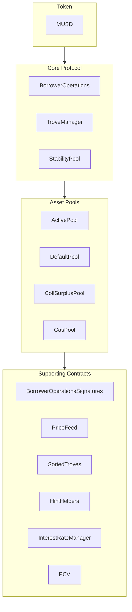

MUSD는 비트코인의 보안성과 탈중앙화를 유지하면서 안정적인 가치 저장 수단을 제공하는 비트코인 담보 스테이블코인입니다. 이 가이드에서는 MUSD의 핵심 아키텍처와 MUSD 스마트 컨트랙트를 통합하는 방법을 다룹니다. MUSD는 [Threshold USD](https://github.com/Threshold-USD/dev)를 기반으로 한 담보부 부채 포지션(CDP)이며, Threshold USD는 [Liquity](https://github.com/liquity/dev)의 포크입니다.

## 아키텍처 개요

이 프로토콜을 사용하면 비트코인 보유자가 BTC를 담보로 MUSD를 발행할 수 있습니다. 즉, 사용자는 비트코인 투자를 그대로 유지하면서 USD 표시 유동성을 활용할 수 있습니다. 핵심 구성 요소는 시스템이 **수탁**을 처리하고, **가격 페그**를 유지하며, **수수료**를 얻는 방식입니다.

### 수탁

사용자는 `BorrowerOperations.openTrove`를 호출해 BTC를 제공하고 MUSD를 요청하는 방식으로 포지션을 엽니다. BTC는 `ActivePool`로 전송되며, 사용자에게 다음 중 하나가 일어날 때까지 그곳에 머뭅니다.

- 담보를 인출합니다(`BorrowerOperations.withdrawColl` 사용).
- 부채를 모두 상환합니다(`BorrowerOperations.closeTrove` 사용).
- 해당 포지션을 대상으로 환매가 이루어집니다(`TroveManager.redeemCollateral` 사용).
- 청산됩니다(`TroveManager.liquidate` 사용).

청산된 포지션은 `StabilityPool`이 부채를 부담하거나(이 경우 BTC는 그곳으로 이전됩니다), 부채와 담보가 흡수되어 다른 사용자에게 재분배됩니다(이 경우 BTC는 `DefaultPool`로 이전됩니다).

### 페그 유지

**\$1의 가격 하한**은 차익 거래, 외부 USD ↔ BTC 가격 오라클, 그리고 MUSD를 1:1 비율로 BTC로 환매할 수 있는 기능(`TroveManager.redeemCollateral` 사용)을 통해 유지됩니다. 거래소에서 MUSD가 `$0.80`에 거래되고 비트코인이 `1 BTC = $100k`에 거래된다고 가정해 보겠습니다. `$800`을 가진 차익 거래자는 다음과 같이 할 수 있습니다.

1. `$800`을 `1000 MUSD`로 교환합니다.
2. `1000 MUSD`를 `0.01 BTC`(`$1000` 상당의 BTC)로 환매합니다.
3. `0.01 BTC`를 `$1000`에 판매합니다.

차익 거래자는 `$200`의 이익을 얻습니다(수수료 제외). 이 거래는 MUSD를 **매수**하고 **소각**하므로, 가격이 `$1`로 돌아올 때까지 가격 상승 압력이 발생합니다.

**\$1.10의 가격 상한**은 최소 담보 비율 110%를 통해 유지됩니다. 거래소에서 MUSD가 `$1.20`에 거래되고 비트코인이 `1 BTC = $100k`에 거래된다고 가정해 보겠습니다. `$100k`를 가진 차익 거래자는 다음과 같이 할 수 있습니다.

1. `1 BTC`(`$100k` 상당)를 매수합니다.
2. `1 BTC`를 담보로 Trove를 열고 최대치인 `90,909 MUSD`를 대출받습니다.
3. `90,909 MUSD`를 `$109,091`에 판매합니다.

차익 거래자는 `$9,091`의 이익을 얻습니다(수수료 제외). 이 거래는 MUSD를 **매도**하고 **발행**하므로, 가격이 `$1.10`에 도달할 때까지 가격 하락 압력이 발생합니다.

### 수수료

프로토콜은 네 곳에서 수수료를 징수합니다.
- 0.1%의 대출 수수료율(거버넌스로 조정 가능): Trove에 부채로 추가되지만 거버넌스에 발행됩니다.
- 0.75%의 환매 수수료율(거버넌스로 조정 가능): 사용자가 MUSD를 BTC로 환매할 때마다 부과됩니다.
- 리파이낸싱 수수료율: 대출 수수료율과 같은 방식으로 작동합니다.
- 대출 원금에 대한 단리 고정 이자.

## 핵심 개념

### 프로토콜 부트스트랩 대출 및 Stability Pool

토큰 보상으로 Stability Pool 예치를 유도하는 프로토콜과 달리, MUSD의 Stability Pool은 처음에 부트스트랩 대출로 채워집니다. 이 MUSD는 청산에만 사용할 수 있습니다. 프로토콜의 MUSD가 청산에 사용되면 먼저 미상환된 프로토콜 대출 잔액을 상환하는 데 쓰이므로, 부트스트랩 대출은 인출될 수 없습니다. 이 대출은 매주 상환될 것으로 예상됩니다.

### 프로토콜 통제 가치(PCV)

시간이 지나 프로토콜에 이자와 수수료가 쌓이면 부트스트랩 대출이 상환되고, Stability Pool의 MUSD 중 프로토콜 통제 가치가 차지하는 비중이 커집니다. PCV 컨트랙트는 이자와 수수료로 누적된 MUSD의 분배를 관리하며, 대출 상환과 수수료 수령자 간의 배분 비율은 거버넌스로 조정할 수 있습니다.

### 불변성과 업그레이드 가능성

MUSD 스마트 컨트랙트는 수정이 가능하도록 업그레이드할 수 있습니다. 중대한 변경을 하려면 새로운 컨트랙트 세트를 배포하고 사용자가 직접 마이그레이션을 선택하도록 해야 하므로, 사용자의 통제권이 보장됩니다. 실전 검증을 거치면 컨트랙트는 불변으로 전환됩니다.

## 저장소 구조

[MUSD 저장소](https://github.com/mezo-org/musd.git)에는 다음이 포함되어 있습니다.

- **[스마트 컨트랙트](https://github.com/mezo-org/musd/tree/main/contracts)**: 핵심 MUSD 프로토콜 컨트랙트
- **[통합 예시](https://github.com/mezo-org/musd/tree/main/examples)**: 샘플 구현
- **[테스트 스위트](https://github.com/mezo-org/musd/tree/main/test)**: 포괄적인 테스트 커버리지
- **[문서](https://github.com/mezo-org/musd/tree/main/docs)**: 기술 사양

## 개발 환경 설정

### 사전 요구 사항

- Node.js 18+(정확한 버전은 [`.nvmrc`](https://github.com/mezo-org/musd/blob/main/.nvmrc) 확인)
- pnpm 패키지 관리자
- 스마트 컨트랙트 개발용 Foundry
- Git

### 설치

1.  저장소를 클론하세요.
    ```bash
    git clone https://github.com/mezo-org/musd.git
    cd musd
    ```
2.  종속성을 설치하세요.
    ```bash
    pnpm install
    ```
3.  환경을 설정하세요.
    ```bash
    cp .env.example .env
    # Edit .env with your configuration
    ```

## 시스템 개요

MUSD 시스템은 네 가지 주요 컨트랙트 그룹으로 구성됩니다.



-   **핵심 프로토콜**: 포지션 열기/닫기, 담보 관리 등 주요 작업을 처리합니다.
-   **자산 풀**: 시스템의 다양한 담보 풀과 유동성 풀을 관리합니다.
-   **지원 컨트랙트**: 가격 피드, 원격 Trove 관리, PCV 등의 서비스를 제공합니다.

## 통합 가이드

### Trove 열기

가스 효율을 최적화하려면 정렬된 목록에서 Trove가 삽입될 위치에 대한 힌트를 제공하세요.

```typescript
async function openTroveWithHints(
  contracts: {
    borrowerOperations: Contract,
    troveManager: Contract,
    sortedTroves: Contract,
    hintHelpers: Contract
  },
  wallet: Wallet,
  debtAmount: bigint,
  assetAmount: bigint
) {
  // Compute expected total debt by adding gas compensation and fee
  const gasCompensation = await contracts.troveManager.MUSD_GAS_COMPENSATION();
  const expectedFee = 
    await contracts.borrowerOperations.getBorrowingFee(debtAmount);
  const expectedTotalDebt = debtAmount + expectedFee + gasCompensation;

  const nicr = (assetAmount * BigInt(1e20)) / expectedTotalDebt;

  const { '0': approxHint } = await contracts.hintHelpers.getApproxHint(nicr, 15, 42);

  const { '0': upperHint, '1': lowerHint } =
    await contracts.sortedTroves.findInsertPosition(nicr, approxHint, approxHint);

  await contracts.borrowerOperations
    .connect(wallet)
    .openTrove(debtAmount, upperHint, lowerHint, { value: assetAmount });
}
```

### Trove 조정 및 닫기

같은 방식으로 Trove를 조정(`adjustTrove`)하거나 닫을(`closeTrove`) 수 있습니다. MUSD 인출/상환과 담보 추가/인출을 위한 편의 함수도 제공됩니다. 전체 예시는 [데모 테스트 파일](https://github.com/mezo-org/musd/blob/main/test/integration/Demo.test.ts)을 참고하세요.

## 청산

Trove의 담보 비율이 110% 아래로 떨어지면 누구나 해당 Trove를 청산할 수 있습니다. 청산자는 가스 보상과 Trove 담보의 일정 비율을 보상으로 받습니다.

### 청산 흐름

1.  **Stability Pool이 있는 경우**: Stability Pool의 MUSD가 소각되어 부채를 충당하고, Stability Pool이 담보를 가져갑니다.
2.  **Stability Pool이 부족한 경우**: 풀의 잔액이 부족하면 가능한 만큼만 충당하고, 남은 부채/담보는 다른 활성 Trove에 재분배됩니다.
3.  **Stability Pool이 비어 있는 경우**: 모든 부채와 담보가 다른 활성 Trove에 재분배됩니다.

### 청산 실행

```typescript
async function liquidateTrove(
  troveManager: Contract,
  wallet: Wallet,
  borrowerAddress: string
) {
  await troveManager.connect(wallet).liquidate(borrowerAddress);
}

async function batchLiquidate(
  troveManager: Contract,
  wallet: Wallet,
  troveAddresses: string[]
) {
  await troveManager.connect(wallet).batchLiquidateTroves(troveAddresses);
}
```

## 환매

MUSD 보유자는 누구나 토큰을 같은 가치의 BTC로 환매할 수 있으며, 이는 `$1` 페그 유지에 도움이 됩니다. 시스템은 담보 비율이 가장 낮은 Trove를 대상으로 환매를 처리합니다.

단계별 안내와 코드는 전용 가이드를 참고하세요.

- [MUSD 환매](/docs/kr/docs/developers/musd/musd-redemptions/)

## 차입자 위험

-   **청산 위험**: 담보 가치가 부채의 110% 아래로 떨어지면 담보가 청산될 수 있습니다.
-   **환매 위험**: 페그 유지를 위해 담보가 환매될 수 있으며, 이로 인해 과세 대상 이벤트가 발생하고 가격 상승에 따른 이익 기회를 잃게 됩니다.
-   **부실 부채**: 극단적인 경우 부실 부채가 다른 차입자들에게 분담될 수 있습니다.

## 테스트

```bash
# Run all tests
pnpm test

# Run with gas reporting
pnpm test:gas

# Run with coverage
pnpm coverage
```

## THUSD 대비 주요 변경 사항

-   **고정 이자 대출**: 이자율은 Trove를 열 때 고정되며 리파이낸싱할 수 있습니다.
-   **프로토콜 통제 가치(PCV)**: 대출 상환과 기타 시스템 운영에 필요한 수수료를 관리합니다.
-   **EIP-712 서명 검증**: 가스 없이 트랜잭션을 승인할 수 있습니다.
-   **Recovery Mode 전용 청산 없음**: 청산은 단일 절차를 따릅니다.

## 정의

-   **Trove**: 담보부 부채 포지션(CDP)입니다.
-   **ICR**: 개별 Trove의 개별 담보 비율(Individual Collateralization Ratio)입니다.
-   **TCR**: 전체 시스템의 총 담보 비율(Total Collateralization Ratio)입니다.
-   **Recovery Mode(복구 모드)**: TCR이 150% 아래로 떨어지면 활성화되며, 더 엄격한 대출 규칙이 적용됩니다.

## 추가 리소스

-   **[MUSD 메인 README](https://github.com/mezo-org/musd/blob/main/README.md)** - 아키텍처 전반에 대한 종합 개요입니다.
-   **[데모 테스트 스위트](https://github.com/mezo-org/musd/blob/main/test/integration/Demo.test.ts)** - 실제로 동작하는 코드 예시입니다.
-   **[MUSD 사용자 가이드](/docs/kr/docs/users/borrow/)** - 최종 사용자용 문서입니다.
