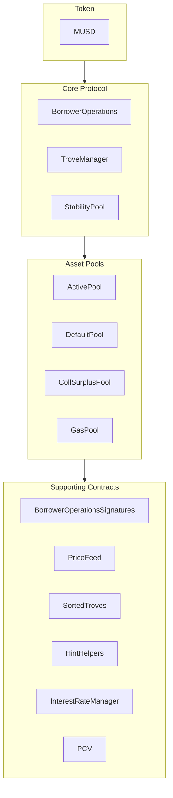

MUSD is een door Bitcoin gedekte stablecoin die een stabiele waardeopslag biedt en tegelijk de veiligheid en decentralisatie van Bitcoin behoudt. Deze handleiding behandelt de kernarchitectuur van MUSD en hoe je met de smart contracts integreert. MUSD is een collateralized debt position (CDP) op basis van [Threshold USD](https://github.com/Threshold-USD/dev), dat een fork is van [Liquity](https://github.com/liquity/dev).

## Architectuuroverzicht

Met het protocol kunnen Bitcoin-houders MUSD minten door hun BTC als onderpand te gebruiken. Zo krijgen gebruikers toegang tot liquiditeit in USD terwijl hun Bitcoin-investering intact blijft. De belangrijkste onderdelen zijn hoe het systeem omgaat met **bewaring**, hoe het de **prijskoppeling** handhaaft en hoe het **vergoedingen** verdient.

### Bewaring

Een gebruiker opent een positie door `BorrowerOperations.openTrove` aan te roepen, BTC aan te leveren en MUSD aan te vragen. De BTC wordt naar de `ActivePool` geleid, waar het blijft totdat een gebruiker:

- opneemt (via `BorrowerOperations.withdrawColl`).
- de schuld aflost (via `BorrowerOperations.closeTrove`).
- wordt ingewisseld (via `TroveManager.redeemCollateral`).
- wordt geliquideerd (via `TroveManager.liquidate`).

Geliquideerde posities worden ofwel betaald door de `StabilityPool`, in welk geval de BTC daarheen wordt overgemaakt, ofwel worden de schuld en het onderpand overgenomen en herverdeeld over andere gebruikers, in welk geval de BTC naar de `DefaultPool` wordt overgemaakt.

### De koppeling handhaven

We handhaven de **prijsbodem van \$1** via arbitrage, een extern prijsorakel voor USD ↔ BTC en de mogelijkheid om MUSD tegen een koers van 1:1 in te wisselen voor BTC (via `TroveManager.redeemCollateral`). Stel dat MUSD op een exchange voor `$0.80` wordt verhandeld en dat Bitcoin wordt verkocht voor `1 BTC = $100k`. Een arbitrageur met `$800` zou het volgende kunnen doen:

1. `$800` omruilen voor `1000 MUSD`.
2. `1000 MUSD` inwisselen voor `0.01 BTC` (BTC ter waarde van `$1000`).
3. `0.01 BTC` verkopen voor `$1000`.

De arbitrageur maakt `$200` winst (kosten buiten beschouwing gelaten). Deze transactie **koopt** MUSD en **verbrandt** het, wat opwaartse prijsdruk veroorzaakt totdat de prijs weer op `$1` staat.

We handhaven een **prijsplafond van \$1,10** via de minimale collateralisatieratio van 110%. Stel dat MUSD op een exchange voor `$1.20` wordt verhandeld en dat Bitcoin wordt verkocht voor `1 BTC = $100k`. Een arbitrageur met `$100k` zou het volgende kunnen doen:

1. `1 BTC` kopen (ter waarde van `$100k`).
2. Een Trove openen met `1 BTC` als onderpand en het maximum van `90,909 MUSD` lenen.
3. `90,909 MUSD` verkopen voor `$109,091`.

De arbitrageur maakt `$9,091` winst (kosten buiten beschouwing gelaten). Deze transactie **verkoopt** en **mint** MUSD, wat neerwaartse prijsdruk veroorzaakt totdat de prijs `$1.10` bereikt.

### Vergoedingen

Het protocol int op vier plaatsen vergoedingen:
- Een leentarief van 0,1% (aanpasbaar via governance), dat als schuld aan een Trove wordt toegevoegd maar aan governance wordt gemint.
- Een inwisselingstarief van 0,75% (aanpasbaar via governance), dat wordt ingehouden wanneer een gebruiker MUSD inwisselt voor BTC.
- Een herfinancieringstarief, dat werkt zoals het leentarief.
- Enkelvoudige, vaste rente over de hoofdsom van de lening.

## Kernideeën

### Bootstraplening van het protocol en Stability Pool

Anders dan protocollen die stortingen in de Stability Pool stimuleren met tokenbeloningen, wordt de Stability Pool van MUSD in eerste instantie gevuld met een bootstraplening. Deze MUSD kan alleen voor liquidaties worden gebruikt. Wanneer de MUSD van het protocol bij een liquidatie wordt gebruikt, wordt die eerst ingezet om een eventueel openstaand saldo van de protocollening af te lossen, zodat de bootstraplening niet kan worden opgenomen. Naar verwachting wordt deze lening wekelijks afgelost.

### Protocol Controlled Value (PCV)

Naarmate het protocol rente en vergoedingen opbouwt, wordt de bootstraplening na verloop van tijd afgelost en groeit het deel van de MUSD in de Stability Pool dat Protocol Controlled Value is. Het PCV-contract beheert de verdeling van de opgebouwde MUSD uit rente en vergoedingen, waarbij de verdeling tussen aflossing van de lening en een ontvanger van vergoedingen via governance kan worden aangepast.

### Onveranderlijkheid en upgradebaarheid

De smart contracts van MUSD zijn upgradebaar, zodat er fixes kunnen worden doorgevoerd. Voor ingrijpende wijzigingen zou een nieuwe set contracten moeten worden gedeployd, waarna gebruikers er zelf voor kiezen om te migreren; zo houden gebruikers de controle. Zodra de contracten zich in de praktijk hebben bewezen, worden ze onveranderlijk gemaakt.

## Structuur van de repository

De [MUSD-repository](https://github.com/mezo-org/musd.git) bevat:

- **[Smart contracts](https://github.com/mezo-org/musd/tree/main/contracts)**: de kerncontracten van het MUSD-protocol
- **[Integratievoorbeelden](https://github.com/mezo-org/musd/tree/main/examples)**: voorbeeldimplementaties
- **[Testsuite](https://github.com/mezo-org/musd/tree/main/test)**: uitgebreide testdekking
- **[Documentatie](https://github.com/mezo-org/musd/tree/main/docs)**: technische specificaties

## Ontwikkelomgeving instellen

### Vereisten

- Node.js 18+ (zie [`.nvmrc`](https://github.com/mezo-org/musd/blob/main/.nvmrc) voor de exacte versie)
- De pakketbeheerder pnpm
- Foundry voor de ontwikkeling van smart contracts
- Git

### Installatie

1.  Kloon de repository:
    ```bash
    git clone https://github.com/mezo-org/musd.git
    cd musd
    ```
2.  Installeer de dependencies:
    ```bash
    pnpm install
    ```
3.  Stel de omgeving in:
    ```bash
    cp .env.example .env
    # Edit .env with your configuration
    ```

## Systeemoverzicht

Het MUSD-systeem bestaat uit vier hoofdgroepen contracten:



-   **Core Protocol**: verzorgt de hoofdbewerkingen, zoals het openen en sluiten van posities en het beheren van onderpand.
-   **Asset Pools**: beheert de verschillende onderpand- en liquiditeitspools van het systeem.
-   **Supporting Contracts**: levert diensten zoals prijsfeeds, Trove-beheer op afstand en PCV.

## Integratiehandleiding

### Een Trove openen

Geef voor een optimale gasefficiëntie hints mee voor de invoegpositie van de Trove in de gesorteerde lijst.

```typescript
async function openTroveWithHints(
  contracts: {
    borrowerOperations: Contract,
    troveManager: Contract,
    sortedTroves: Contract,
    hintHelpers: Contract
  },
  wallet: Wallet,
  debtAmount: bigint,
  assetAmount: bigint
) {
  // Compute expected total debt by adding gas compensation and fee
  const gasCompensation = await contracts.troveManager.MUSD_GAS_COMPENSATION();
  const expectedFee = 
    await contracts.borrowerOperations.getBorrowingFee(debtAmount);
  const expectedTotalDebt = debtAmount + expectedFee + gasCompensation;

  const nicr = (assetAmount * BigInt(1e20)) / expectedTotalDebt;

  const { '0': approxHint } = await contracts.hintHelpers.getApproxHint(nicr, 15, 42);

  const { '0': upperHint, '1': lowerHint } =
    await contracts.sortedTroves.findInsertPosition(nicr, approxHint, approxHint);

  await contracts.borrowerOperations
    .connect(wallet)
    .openTrove(debtAmount, upperHint, lowerHint, { value: assetAmount });
}
```

### Troves aanpassen en sluiten

Op dezelfde manier kun je Troves aanpassen (`adjustTrove`) of sluiten (`closeTrove`). Er zijn ook gemaksfuncties beschikbaar voor het opnemen/aflossen van MUSD en het toevoegen/opnemen van onderpand. Zie het [demotestbestand](https://github.com/mezo-org/musd/blob/main/test/integration/Demo.test.ts) voor volledige voorbeelden.

## Liquidaties

Wanneer de collateralisatieratio van een Trove onder 110% zakt, kan iedereen die Trove liquideren. De liquidator wordt beloond met een gascompensatie en een percentage van het onderpand van de Trove.

### Liquidatieflows

1.  **Met Stability Pool**: de MUSD van de Stability Pool wordt verbrand om de schuld te dekken, en de pool neemt het onderpand in beslag.
2.  **Gedeeltelijke Stability Pool**: is de pool ontoereikend, dan dekt die wat mogelijk is, en wordt de resterende schuld/het resterende onderpand herverdeeld over andere actieve Troves.
3.  **Lege Stability Pool**: alle schuld en al het onderpand worden herverdeeld over andere actieve Troves.

### Een liquidatie uitvoeren

```typescript
async function liquidateTrove(
  troveManager: Contract,
  wallet: Wallet,
  borrowerAddress: string
) {
  await troveManager.connect(wallet).liquidate(borrowerAddress);
}

async function batchLiquidate(
  troveManager: Contract,
  wallet: Wallet,
  troveAddresses: string[]
) {
  await troveManager.connect(wallet).batchLiquidateTroves(troveAddresses);
}
```

## Inwisselingen

Elke MUSD-houder kan zijn tokens inwisselen voor BTC van gelijke waarde, wat helpt de koppeling op `$1` te houden. Het systeem wisselt in tegen de Trove met de laagste onderpandratio.

Zie de speciale handleiding voor stapsgewijze instructies en code:

- [MUSD-inwisselingen](/docs/nl/docs/developers/musd/musd-redemptions/)

## Risico's voor leners

-   **Liquidatierisico**: je onderpand kan worden geliquideerd als de waarde ervan onder 110% van je schuld zakt.
-   **Inwisselingsrisico**: je onderpand kan worden ingewisseld om de koppeling te handhaven, wat een belastbare gebeurtenis veroorzaakt en ertoe leidt dat je geen blootstelling aan koersstijgingen meer hebt.
-   **Oninbare schuld**: in extreme gevallen kan oninbare schuld over andere leners worden verdeeld.

## Testen

```bash
# Run all tests
pnpm test

# Run with gas reporting
pnpm test:gas

# Run with coverage
pnpm coverage
```

## Belangrijkste wijzigingen ten opzichte van THUSD

-   **Lenen tegen vaste rente**: rentetarieven worden vastgezet wanneer een Trove wordt geopend en kunnen worden geherfinancierd.
-   **Protocol Controlled Value (PCV)**: beheert vergoedingen voor de aflossing van leningen en andere behoeften van het systeem.
-   **Verificatie van EIP-712-handtekeningen**: maakt autorisaties van transacties zonder gas mogelijk.
-   **Geen speciale liquidaties in Recovery Mode**: liquidaties volgen één enkel proces.

## Definities

-   **Trove**: een collateralized debt position (CDP).
-   **ICR**: Individual Collateralization Ratio, de collateralisatieratio van een individuele Trove.
-   **TCR**: Total Collateralization Ratio, de totale collateralisatieratio van het hele systeem.
-   **Recovery Mode**: wordt geactiveerd als de TCR onder 150% zakt en legt strengere leenregels op.

## Aanvullende bronnen

-   **[Hoofd-README van MUSD](https://github.com/mezo-org/musd/blob/main/README.md)**: uitgebreid architectuuroverzicht.
-   **[Demotestsuite](https://github.com/mezo-org/musd/blob/main/test/integration/Demo.test.ts)**: werkende codevoorbeelden.
-   **[Gebruikershandleiding voor MUSD](/docs/nl/docs/users/borrow/)**: documentatie voor eindgebruikers.
