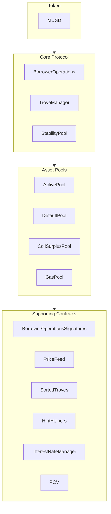

O MUSD é uma stablecoin lastreada em Bitcoin que oferece uma reserva de valor estável, mantendo a segurança e a descentralização do Bitcoin. Este guia aborda a arquitetura principal do MUSD e como integrar seus contratos inteligentes. O MUSD é uma posição de dívida colateralizada (CDP) baseada no [Threshold USD](https://github.com/Threshold-USD/dev), que é um fork do [Liquity](https://github.com/liquity/dev).

## Visão geral da arquitetura

O protocolo permite que detentores de Bitcoin cunhem MUSD usando seu BTC como colateral. Assim, os usuários podem acessar liquidez denominada em USD sem abrir mão do seu investimento em Bitcoin. Os componentes principais são a forma como o sistema faz a **custódia**, mantém a **paridade de preço** e obtém **taxas**.

### Custódia

O usuário abre uma posição chamando `BorrowerOperations.openTrove`, fornecendo BTC e solicitando MUSD. O BTC é encaminhado ao `ActivePool`, onde permanece até que o usuário:

- saque (via `BorrowerOperations.withdrawColl`).
- quite sua dívida (via `BorrowerOperations.closeTrove`).
- sofra um resgate contra sua posição (via `TroveManager.redeemCollateral`).
- seja liquidado (via `TroveManager.liquidate`).

As posições liquidadas são pagas pelo `StabilityPool`, caso em que o BTC é transferido para lá, ou então a dívida e o colateral são absorvidos e redistribuídos a outros usuários, caso em que o BTC é transferido para o `DefaultPool`.

### Manutenção da paridade

Mantemos o **piso de preço de \$1** por meio de arbitragem, de um oráculo externo de preços USD ↔ BTC e da possibilidade de resgatar MUSD por BTC na proporção de 1:1 (via `TroveManager.redeemCollateral`). Imagine que o MUSD esteja sendo negociado a `$0.80` em uma exchange e que o bitcoin esteja sendo vendido a `1 BTC = $100k`. Um arbitrador com `$800` poderia:

1. Trocar `$800` por `1000 MUSD`.
2. Resgatar `1000 MUSD` por `0.01 BTC` (o equivalente a `$1000` em BTC).
3. Vender `0.01 BTC` por `$1000`.

O arbitrador lucra `$200` (desconsiderando as taxas). Essa operação **compra** MUSD e o **queima**, gerando pressão de alta no preço até que ele volte a `$1`.

Mantemos um **teto de preço de \$1,10** por meio do índice de colateralização mínimo de 110%. Imagine que o MUSD esteja sendo negociado a `$1.20` em uma exchange e que o bitcoin esteja sendo vendido a `1 BTC = $100k`. Um arbitrador com `$100k` poderia:

1. Comprar `1 BTC` (no valor de `$100k`).
2. Abrir um Trove com `1 BTC` como colateral e tomar emprestado o máximo de `90,909 MUSD`.
3. Vender `90,909 MUSD` por `$109,091`.

O arbitrador lucra `$9,091` (desconsiderando as taxas). Essa operação **vende** e **cunha** MUSD, gerando pressão de baixa no preço até que ele chegue a `$1.10`.

### Taxas

O protocolo cobra taxas em quatro pontos:
- Uma taxa de empréstimo de 0,1% (ajustável pela governança), que é adicionada como dívida ao Trove, mas cunhada para a governança.
- Uma taxa de resgate de 0,75% (ajustável pela governança), cobrada sempre que um usuário resgata MUSD por BTC.
- Uma taxa de refinanciamento, que funciona como a taxa de empréstimo.
- Juros simples e fixos sobre o principal do empréstimo.

## Ideias centrais

### Empréstimo de bootstrap do protocolo e Stability Pool

Diferentemente dos protocolos que incentivam depósitos no stability pool com recompensas em tokens, o Stability Pool do MUSD é abastecido inicialmente com um empréstimo de bootstrap. Esse MUSD só pode ser usado em liquidações. Quando o MUSD do protocolo é usado em uma liquidação, ele serve primeiro para pagar qualquer saldo pendente do empréstimo do protocolo, o que garante que o empréstimo de bootstrap não possa ser sacado. A expectativa é que os pagamentos desse empréstimo sejam feitos semanalmente.

### Valor controlado pelo protocolo (PCV)

Com o tempo, à medida que o protocolo acumula juros e taxas, o empréstimo de bootstrap é pago e a parcela do MUSD no Stability Pool que corresponde ao valor controlado pelo protocolo (PCV) aumenta. O contrato PCV gerencia a distribuição do MUSD acumulado com juros e taxas, e a divisão entre o pagamento do empréstimo e um destinatário de taxas é ajustável pela governança.

### Imutabilidade e capacidade de atualização

Os contratos inteligentes do MUSD são atualizáveis para permitir correções. Mudanças substanciais exigiriam a implantação de um novo conjunto de contratos e a adesão voluntária dos usuários à migração, o que garante o controle por parte do usuário. Depois de testados em condições reais, os contratos se tornarão imutáveis.

## Estrutura do repositório

O [repositório do MUSD](https://github.com/mezo-org/musd.git) contém:

- **[Contratos inteligentes](https://github.com/mezo-org/musd/tree/main/contracts)**: contratos principais do protocolo MUSD
- **[Exemplos de integração](https://github.com/mezo-org/musd/tree/main/examples)**: implementações de exemplo
- **[Suíte de testes](https://github.com/mezo-org/musd/tree/main/test)**: cobertura de testes abrangente
- **[Documentação](https://github.com/mezo-org/musd/tree/main/docs)**: especificações técnicas

## Configuração de desenvolvimento

### Pré-requisitos

- Node.js 18+ (consulte o [`.nvmrc`](https://github.com/mezo-org/musd/blob/main/.nvmrc) para ver a versão exata)
- Gerenciador de pacotes pnpm
- Foundry para o desenvolvimento de contratos inteligentes
- Git

### Instalação

1.  Clone o repositório:
    ```bash
    git clone https://github.com/mezo-org/musd.git
    cd musd
    ```
2.  Instale as dependências:
    ```bash
    pnpm install
    ```
3.  Configure o ambiente:
    ```bash
    cp .env.example .env
    # Edit .env with your configuration
    ```

## Visão geral do sistema

O sistema MUSD é composto por quatro grupos principais de contratos:



-   **Core Protocol** (protocolo principal): executa as operações principais, como abrir/fechar posições e gerenciar o colateral.
-   **Asset Pools** (pools de ativos): gerencia os diversos pools de colateral e de liquidez do sistema.
-   **Supporting Contracts** (contratos de suporte): fornece serviços como feeds de preços, gerenciamento remoto de Troves e PCV.

## Guia de integração

### Abrir um Trove

Para obter a melhor eficiência de gás, forneça hints da posição de inserção do Trove na lista ordenada.

```typescript
async function openTroveWithHints(
  contracts: {
    borrowerOperations: Contract,
    troveManager: Contract,
    sortedTroves: Contract,
    hintHelpers: Contract
  },
  wallet: Wallet,
  debtAmount: bigint,
  assetAmount: bigint
) {
  // Compute expected total debt by adding gas compensation and fee
  const gasCompensation = await contracts.troveManager.MUSD_GAS_COMPENSATION();
  const expectedFee = 
    await contracts.borrowerOperations.getBorrowingFee(debtAmount);
  const expectedTotalDebt = debtAmount + expectedFee + gasCompensation;

  const nicr = (assetAmount * BigInt(1e20)) / expectedTotalDebt;

  const { '0': approxHint } = await contracts.hintHelpers.getApproxHint(nicr, 15, 42);

  const { '0': upperHint, '1': lowerHint } =
    await contracts.sortedTroves.findInsertPosition(nicr, approxHint, approxHint);

  await contracts.borrowerOperations
    .connect(wallet)
    .openTrove(debtAmount, upperHint, lowerHint, { value: assetAmount });
}
```

### Ajustar e fechar Troves

Da mesma forma, você pode ajustar (`adjustTrove`) ou fechar (`closeTrove`) Troves. Também há funções de conveniência para sacar/pagar MUSD e adicionar/sacar colateral. Para ver exemplos completos, consulte o [arquivo de teste de demonstração](https://github.com/mezo-org/musd/blob/main/test/integration/Demo.test.ts).

## Liquidações

Quando o índice de colateralização de um Trove cai abaixo de 110%, ele pode ser liquidado por qualquer pessoa. O liquidante é recompensado com uma compensação de gás e uma porcentagem do colateral do Trove.

### Fluxos de liquidação

1.  **Com o Stability Pool**: o MUSD do Stability Pool é queimado para cobrir a dívida, e o pool fica com o colateral.
2.  **Stability Pool parcial**: se o pool for insuficiente, ele cobre o que puder, e a dívida/colateral restante é redistribuída para outros Troves ativos.
3.  **Stability Pool vazio**: toda a dívida e todo o colateral são redistribuídos para outros Troves ativos.

### Executar uma liquidação

```typescript
async function liquidateTrove(
  troveManager: Contract,
  wallet: Wallet,
  borrowerAddress: string
) {
  await troveManager.connect(wallet).liquidate(borrowerAddress);
}

async function batchLiquidate(
  troveManager: Contract,
  wallet: Wallet,
  troveAddresses: string[]
) {
  await troveManager.connect(wallet).batchLiquidateTroves(troveAddresses);
}
```

## Resgates

Qualquer detentor de MUSD pode resgatar seus tokens por um valor equivalente em BTC, o que ajuda a manter a paridade de `$1`. O sistema faz o resgate contra o Trove com o menor índice de colateralização.

Para ver instruções passo a passo e código, consulte o guia específico:

- [Resgates de MUSD](/docs/pt-br/docs/developers/musd/musd-redemptions/)

## Riscos para o tomador

-   **Risco de liquidação**: seu colateral pode ser liquidado se o valor dele cair abaixo de 110% da sua dívida.
-   **Risco de resgate**: seu colateral pode ser resgatado para manter a paridade, o que gera um evento tributável e a perda da exposição à valorização.
-   **Dívida incobrável**: em casos extremos, a dívida incobrável pode ser socializada entre os demais tomadores.

## Testes

```bash
# Run all tests
pnpm test

# Run with gas reporting
pnpm test:gas

# Run with coverage
pnpm coverage
```

## Principais mudanças em relação ao THUSD

-   **Empréstimos com juros fixos**: as taxas de juros são fixadas quando um Trove é aberto e podem ser refinanciadas.
-   **Valor controlado pelo protocolo (PCV)**: gerencia as taxas destinadas ao pagamento de empréstimos e a outras necessidades do sistema.
-   **Verificação de assinaturas EIP-712**: permite autorizar transações sem gás.
-   **Sem liquidações especiais no Recovery Mode**: as liquidações seguem um processo único.

## Definições

-   **Trove**: uma posição de dívida colateralizada (CDP).
-   **ICR**: índice de colateralização individual de um único Trove.
-   **TCR**: índice de colateralização total de todo o sistema.
-   **Recovery Mode**: ativado se o TCR cair abaixo de 150%, impondo regras de empréstimo mais rígidas.

## Recursos adicionais

-   **[README principal do MUSD](https://github.com/mezo-org/musd/blob/main/README.md)**: visão geral abrangente da arquitetura.
-   **[Suíte de testes de demonstração](https://github.com/mezo-org/musd/blob/main/test/integration/Demo.test.ts)**: exemplos de código funcionais.
-   **[Guia do usuário do MUSD](/docs/pt-br/docs/users/borrow/)**: documentação para usuários finais.
