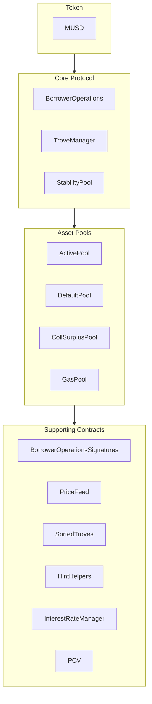

MUSD — обеспеченный биткоином стейблкоин, который служит стабильным средством сбережения, сохраняя безопасность и децентрализацию Bitcoin. В этом руководстве описаны базовая архитектура MUSD и интеграция с его смарт-контрактами. MUSD — это обеспеченная долговая позиция (CDP) на основе [Threshold USD](https://github.com/Threshold-USD/dev), который, в свою очередь, является форком [Liquity](https://github.com/liquity/dev).

## Обзор архитектуры

Протокол позволяет держателям биткоина выпускать MUSD, используя свои BTC в качестве залога. Это значит, что пользователи получают доступ к ликвидности в долларах США, сохраняя свои вложения в биткоин. Ключевые аспекты — то, как система обеспечивает **хранение**, поддерживает **привязку цены** и получает **комиссии**.

### Хранение

Пользователь открывает позицию, вызывая `BorrowerOperations.openTrove`, предоставляя BTC и запрашивая MUSD. BTC направляются в `ActivePool` и остаются там, пока не произойдёт одно из следующего:

- пользователь выведет их (через `BorrowerOperations.withdrawColl`);
- пользователь погасит свой долг (через `BorrowerOperations.closeTrove`);
- против позиции пользователя будет проведён выкуп (через `TroveManager.redeemCollateral`);
- позиция пользователя будет ликвидирована (через `TroveManager.liquidate`).

Ликвидированные позиции либо покрываются за счёт `StabilityPool` — в этом случае BTC переводятся туда, — либо долг и залог поглощаются и перераспределяются между другими пользователями — в этом случае BTC переводятся в `DefaultPool`.

### Поддержание привязки

**Нижняя граница цены в \$1** поддерживается за счёт арбитража, внешнего ценового оракула USD ↔ BTC и возможности выкупить BTC за MUSD по курсу 1:1 (через `TroveManager.redeemCollateral`). Представим, что MUSD торгуется на бирже по `$0.80`, а биткоин продаётся по курсу `1 BTC = $100k`. Арбитражёр с `$800` может:

1. Обменять `$800` на `1000 MUSD`.
2. Выкупить за `1000 MUSD` `0.01 BTC` (BTC на сумму `$1000`).
3. Продать `0.01 BTC` за `$1000`.

Арбитражёр получает прибыль `$200` (без учёта комиссий). Эта сделка **покупает** MUSD и **сжигает** их, создавая давление на цену вверх, пока цена не вернётся к `$1`.

**Верхняя граница цены в \$1,10** поддерживается за счёт минимального коэффициента обеспечения 110%. Представим, что MUSD торгуется на бирже по `$1.20`, а биткоин продаётся по курсу `1 BTC = $100k`. Арбитражёр с `$100k` может:

1. Купить `1 BTC` (стоимостью `$100k`).
2. Открыть Trove с `1 BTC` в качестве залога и занять максимальные `90,909 MUSD`.
3. Продать `90,909 MUSD` за `$109,091`.

Арбитражёр получает прибыль `$9,091` (без учёта комиссий). Эта сделка **продаёт** и **выпускает** MUSD, создавая давление на цену вниз, пока цена не достигнет `$1.10`.

### Комиссии

Протокол взимает комиссии в четырёх случаях:
- Ставка за заём 0,1% (настраивается через управление): добавляется к долгу Trove, но выпускается в пользу управления.
- Ставка за выкуп 0,75% (настраивается через управление): взимается каждый раз, когда пользователь выкупает BTC за MUSD.
- Ставка за рефинансирование: работает так же, как ставка за заём.
- Простые фиксированные проценты на основную сумму займа.

## Ключевые идеи

### Стартовый заём протокола и Stability Pool

В отличие от протоколов, которые стимулируют депозиты в stability pool вознаграждениями в токенах, Stability Pool в MUSD изначально наполняется стартовым займом. Эти MUSD можно использовать только для ликвидаций. Когда MUSD протокола используются при ликвидации, они в первую очередь идут на погашение непогашенного остатка займа протокола, поэтому стартовый заём невозможно вывести. Погашение этого займа планируется проводить еженедельно.

### Стоимость под контролем протокола (PCV)

Со временем, по мере того как протокол накапливает проценты и комиссии, стартовый заём погашается, и доля MUSD в Stability Pool, представляющая собой стоимость под контролем протокола, растёт. Контракт PCV управляет распределением MUSD, накопленных из процентов и комиссий; пропорция между погашением займа и получателем комиссий настраивается через управление.

### Неизменяемость и возможность обновления

Смарт-контракты MUSD обновляемы, чтобы можно было вносить исправления. Существенные изменения потребуют развёртывания нового набора контрактов, на который пользователи будут переходить добровольно, — так контроль остаётся за пользователями. После проверки в реальных условиях контракты станут неизменяемыми.

## Структура репозитория

[Репозиторий MUSD](https://github.com/mezo-org/musd.git) содержит:

- **[Смарт-контракты](https://github.com/mezo-org/musd/tree/main/contracts)**: основные контракты протокола MUSD
- **[Примеры интеграции](https://github.com/mezo-org/musd/tree/main/examples)**: примеры реализаций
- **[Набор тестов](https://github.com/mezo-org/musd/tree/main/test)**: полное тестовое покрытие
- **[Документация](https://github.com/mezo-org/musd/tree/main/docs)**: технические спецификации

## Настройка среды разработки

### Предварительные требования

- Node.js 18+ (точную версию см. в [`.nvmrc`](https://github.com/mezo-org/musd/blob/main/.nvmrc))
- менеджер пакетов pnpm
- Foundry для разработки смарт-контрактов
- Git

### Установка

1.  Клонируйте репозиторий:
    ```bash
    git clone https://github.com/mezo-org/musd.git
    cd musd
    ```
2.  Установите зависимости:
    ```bash
    pnpm install
    ```
3.  Настройте окружение:
    ```bash
    cp .env.example .env
    # Edit .env with your configuration
    ```

## Обзор системы

Система MUSD состоит из четырёх основных групп контрактов:



-   **Ядро протокола**: выполняет основные операции, такие как открытие и закрытие позиций и управление залогом.
-   **Пулы активов**: управляют различными пулами залога и ликвидности системы.
-   **Вспомогательные контракты**: предоставляют такие сервисы, как ценовые потоки, удалённое управление Trove и PCV.

## Руководство по интеграции

### Открытие Trove

Для оптимального расхода газа передавайте подсказки (hints) о позиции вставки Trove в отсортированный список.

```typescript
async function openTroveWithHints(
  contracts: {
    borrowerOperations: Contract,
    troveManager: Contract,
    sortedTroves: Contract,
    hintHelpers: Contract
  },
  wallet: Wallet,
  debtAmount: bigint,
  assetAmount: bigint
) {
  // Compute expected total debt by adding gas compensation and fee
  const gasCompensation = await contracts.troveManager.MUSD_GAS_COMPENSATION();
  const expectedFee = 
    await contracts.borrowerOperations.getBorrowingFee(debtAmount);
  const expectedTotalDebt = debtAmount + expectedFee + gasCompensation;

  const nicr = (assetAmount * BigInt(1e20)) / expectedTotalDebt;

  const { '0': approxHint } = await contracts.hintHelpers.getApproxHint(nicr, 15, 42);

  const { '0': upperHint, '1': lowerHint } =
    await contracts.sortedTroves.findInsertPosition(nicr, approxHint, approxHint);

  await contracts.borrowerOperations
    .connect(wallet)
    .openTrove(debtAmount, upperHint, lowerHint, { value: assetAmount });
}
```

### Изменение и закрытие Trove

Аналогичным образом можно изменять (`adjustTrove`) или закрывать (`closeTrove`) Trove. Также доступны вспомогательные функции для получения и погашения MUSD и для внесения и вывода залога. Полные примеры см. в [демонстрационном тестовом файле](https://github.com/mezo-org/musd/blob/main/test/integration/Demo.test.ts).

## Ликвидации

Когда коэффициент обеспечения Trove опускается ниже 110%, ликвидировать его может кто угодно. Ликвидатор получает в качестве вознаграждения компенсацию газа и процент от залога Trove.

### Сценарии ликвидации

1.  **Со Stability Pool**: MUSD из Stability Pool сжигаются для покрытия долга, а залог переходит к Stability Pool.
2.  **Частичное покрытие из Stability Pool**: если средств пула недостаточно, он покрывает то, что может, а оставшиеся долг и залог перераспределяются между другими активными Trove.
3.  **Пустой Stability Pool**: весь долг и залог перераспределяются между другими активными Trove.

### Выполнение ликвидации

```typescript
async function liquidateTrove(
  troveManager: Contract,
  wallet: Wallet,
  borrowerAddress: string
) {
  await troveManager.connect(wallet).liquidate(borrowerAddress);
}

async function batchLiquidate(
  troveManager: Contract,
  wallet: Wallet,
  troveAddresses: string[]
) {
  await troveManager.connect(wallet).batchLiquidateTroves(troveAddresses);
}
```

## Выкуп

Любой держатель MUSD может обменять свои токены на BTC эквивалентной стоимости через выкуп, что помогает поддерживать привязку к `$1`. Система проводит выкуп за счёт Trove с самым низким коэффициентом обеспечения.

Пошаговые инструкции и код см. в отдельном руководстве:

- [Выкуп MUSD](/docs/ru/docs/developers/musd/musd-redemptions/)

## Риски заёмщика

-   **Риск ликвидации**: ваш залог может быть ликвидирован, если его стоимость опустится ниже 110% от вашего долга.
-   **Риск выкупа**: ваш залог может быть выкуплен для поддержания привязки, что создаёт налогооблагаемое событие и лишает вас потенциального роста стоимости.
-   **Безнадёжный долг**: в крайних случаях безнадёжный долг может быть распределён между другими заёмщиками.

## Тестирование

```bash
# Run all tests
pnpm test

# Run with gas reporting
pnpm test:gas

# Run with coverage
pnpm coverage
```

## Ключевые отличия от THUSD

-   **Займы с фиксированной ставкой**: процентная ставка фиксируется при открытии Trove и может быть рефинансирована.
-   **Стоимость под контролем протокола (PCV)**: управляет комиссиями для погашения займа и других нужд системы.
-   **Проверка подписей EIP-712**: позволяет авторизовать транзакции без оплаты газа.
-   **Нет особых ликвидаций в Recovery Mode**: ликвидации проходят по единому процессу.

## Определения

-   **Trove**: обеспеченная долговая позиция (CDP).
-   **ICR**: индивидуальный коэффициент обеспечения (Individual Collateralization Ratio) отдельного Trove.
-   **TCR**: общий коэффициент обеспечения (Total Collateralization Ratio) всей системы.
-   **Recovery Mode (режим восстановления)**: включается, если TCR опускается ниже 150%, и вводит более строгие правила заимствования.

## Дополнительные ресурсы

-   **[Основной README MUSD](https://github.com/mezo-org/musd/blob/main/README.md)** — подробный обзор архитектуры.
-   **[Демонстрационный набор тестов](https://github.com/mezo-org/musd/blob/main/test/integration/Demo.test.ts)** — рабочие примеры кода.
-   **[Руководство пользователя MUSD](/docs/ru/docs/users/borrow/)** — документация для конечных пользователей.
