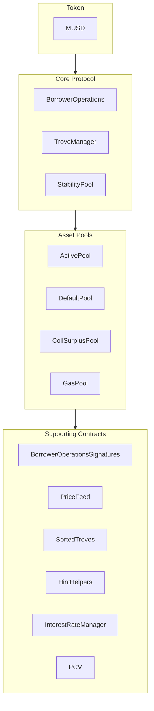

MUSD — це стейблкоїн, забезпечений біткоїном, що слугує стабільним засобом збереження вартості й водночас зберігає безпеку та децентралізацію Bitcoin. У цьому посібнику розглянуто основну архітектуру MUSD і те, як інтегруватися з його смарт-контрактами. MUSD — це позикова позиція під заставу (CDP) на основі [Threshold USD](https://github.com/Threshold-USD/dev), який є форком [Liquity](https://github.com/liquity/dev).

## Огляд архітектури

Протокол дає змогу власникам біткоїна випускати MUSD, використовуючи свої BTC як заставу. Це означає, що користувачі можуть отримати доступ до ліквідності в доларах США, зберігаючи свої інвестиції в біткоїн. Основні складники — це те, як система забезпечує **зберігання**, підтримує **цінову прив'язку** та заробляє **комісії**.

### Зберігання

Користувач відкриває позицію, викликаючи `BorrowerOperations.openTrove`, надаючи BTC і запитуючи MUSD. BTC спрямовуються до `ActivePool`, де залишаються, доки користувач:

- не виведе їх (через `BorrowerOperations.withdrawColl`);
- не погасить свій борг (через `BorrowerOperations.closeTrove`);
- не зазнає викупу (через `TroveManager.redeemCollateral`);
- не буде ліквідований (через `TroveManager.liquidate`).

Ліквідовані позиції або покриваються з `StabilityPool` — тоді BTC переказуються туди, — або борг і застава поглинаються й перерозподіляються між іншими користувачами — тоді BTC переказуються до `DefaultPool`.

### Підтримання прив'язки

Ми підтримуємо **нижню межу ціни в \$1** завдяки арбітражу, зовнішньому ціновому оракулу USD ↔ BTC і можливості викупити MUSD за BTC у співвідношенні 1:1 (через `TroveManager.redeemCollateral`). Уявіть, що MUSD торгується на біржі по `$0.80`, а біткоїн продається за курсом `1 BTC = $100k`. Арбітражер із `$800` може:

1. Обміняти `$800` на `1000 MUSD`.
2. Викупити `1000 MUSD` за `0.01 BTC` (BTC вартістю `$1000`).
3. Продати `0.01 BTC` за `$1000`.

Арбітражер отримує прибуток `$200` (без урахування комісій). Ця угода **купує** MUSD і **спалює** його, створюючи тиск на ціну вгору, доки ціна не повернеться до `$1`.

Ми підтримуємо **верхню межу ціни в \$1,10** завдяки мінімальному коефіцієнту забезпечення 110%. Уявіть, що MUSD торгується на біржі по `$1.20`, а біткоїн продається за курсом `1 BTC = $100k`. Арбітражер із `$100k` може:

1. Купити `1 BTC` (вартістю `$100k`).
2. Відкрити Trove з `1 BTC` у заставі й позичити максимальні `90,909 MUSD`.
3. Продати `90,909 MUSD` за `$109,091`.

Арбітражер отримує прибуток `$9,091` (без урахування комісій). Ця угода **продає** і **випускає** MUSD, створюючи тиск на ціну вниз, доки ціна не досягне `$1.10`.

### Комісії

Протокол стягує комісії в чотирьох місцях:
- Ставка позики 0,1% (регулюється врядуванням), яка додається до Trove як борг, але випускається на користь врядування.
- Ставка викупу 0,75% (регулюється врядуванням), яка стягується щоразу, коли користувач викуповує MUSD за BTC.
- Ставка рефінансування, яка діє так само, як ставка позики.
- Прості фіксовані відсотки на основну суму позики.

## Ключові ідеї

### Стартова позика протоколу та Stability Pool

На відміну від протоколів, які стимулюють депозити в stability pool винагородами в токенах, Stability Pool MUSD спочатку наповнюється стартовою позикою. Ці MUSD можна використовувати лише для ліквідацій. Коли MUSD протоколу використовуються під час ліквідації, ними насамперед погашають непогашений залишок позики протоколу, що унеможливлює виведення стартової позики. Погашення цієї позики планується щотижня.

### Вартість під контролем протоколу (PCV)

З часом, у міру того як протокол накопичує відсотки й комісії, стартова позика погашається, а частка MUSD у Stability Pool, яка є вартістю під контролем протоколу (Protocol Controlled Value), зростає. Контракт PCV керує розподілом накопичених MUSD із відсотків і комісій, а співвідношення між погашенням позики та отримувачем комісій регулюється врядуванням.

### Незмінність і можливість оновлення

Смарт-контракти MUSD можна оновлювати, щоб вносити виправлення. Суттєві зміни вимагатимуть розгортання нового набору контрактів і добровільної міграції користувачів, що залишає контроль у руках користувачів. Після перевірки в реальних умовах контракти стануть незмінними.

## Структура репозиторію

[Репозиторій MUSD](https://github.com/mezo-org/musd.git) містить:

- **[Смарт-контракти](https://github.com/mezo-org/musd/tree/main/contracts)**: основні контракти протоколу MUSD
- **[Приклади інтеграції](https://github.com/mezo-org/musd/tree/main/examples)**: зразки реалізацій
- **[Набір тестів](https://github.com/mezo-org/musd/tree/main/test)**: всебічне тестове покриття
- **[Документація](https://github.com/mezo-org/musd/tree/main/docs)**: технічні специфікації

## Налаштування середовища розробки

### Передумови

- Node.js 18+ (точну версію див. у [`.nvmrc`](https://github.com/mezo-org/musd/blob/main/.nvmrc))
- Менеджер пакетів pnpm
- Foundry для розробки смарт-контрактів
- Git

### Встановлення

1.  Клонуйте репозиторій:
    ```bash
    git clone https://github.com/mezo-org/musd.git
    cd musd
    ```
2.  Встановіть залежності:
    ```bash
    pnpm install
    ```
3.  Налаштуйте середовище:
    ```bash
    cp .env.example .env
    # Edit .env with your configuration
    ```

## Огляд системи

Система MUSD складається з чотирьох основних груп контрактів:



-   **Основний протокол (Core Protocol)**: виконує основні операції, як-от відкриття/закриття позицій і керування заставою.
-   **Пули активів (Asset Pools)**: керують різними пулами застави та ліквідності системи.
-   **Допоміжні контракти (Supporting Contracts)**: надають такі сервіси, як цінові потоки, віддалене керування Trove і PCV.

## Посібник з інтеграції

### Відкриття Trove

Для оптимальної ефективності витрат газу передавайте підказки (hints) щодо позиції вставлення Trove у відсортований список.

```typescript
async function openTroveWithHints(
  contracts: {
    borrowerOperations: Contract,
    troveManager: Contract,
    sortedTroves: Contract,
    hintHelpers: Contract
  },
  wallet: Wallet,
  debtAmount: bigint,
  assetAmount: bigint
) {
  // Compute expected total debt by adding gas compensation and fee
  const gasCompensation = await contracts.troveManager.MUSD_GAS_COMPENSATION();
  const expectedFee = 
    await contracts.borrowerOperations.getBorrowingFee(debtAmount);
  const expectedTotalDebt = debtAmount + expectedFee + gasCompensation;

  const nicr = (assetAmount * BigInt(1e20)) / expectedTotalDebt;

  const { '0': approxHint } = await contracts.hintHelpers.getApproxHint(nicr, 15, 42);

  const { '0': upperHint, '1': lowerHint } =
    await contracts.sortedTroves.findInsertPosition(nicr, approxHint, approxHint);

  await contracts.borrowerOperations
    .connect(wallet)
    .openTrove(debtAmount, upperHint, lowerHint, { value: assetAmount });
}
```

### Коригування та закриття Trove

Аналогічно можна коригувати (`adjustTrove`) або закривати (`closeTrove`) Trove. Також доступні зручні функції для виведення/погашення MUSD і додавання/виведення застави. Повні приклади див. у [демонстраційному тестовому файлі](https://github.com/mezo-org/musd/blob/main/test/integration/Demo.test.ts).

## Ліквідації

Коли коефіцієнт забезпечення Trove падає нижче 110%, будь-хто може його ліквідувати. Ліквідатор отримує винагороду у вигляді компенсації газу та відсотка від застави Trove.

### Сценарії ліквідації

1.  **Зі Stability Pool**: MUSD зі Stability Pool спалюються для покриття боргу, а пул забирає заставу.
2.  **Частковий Stability Pool**: якщо коштів пулу недостатньо, він покриває те, що може, а решта боргу/застави перерозподіляється між іншими активними Trove.
3.  **Порожній Stability Pool**: увесь борг і застава перерозподіляються між іншими активними Trove.

### Виконання ліквідації

```typescript
async function liquidateTrove(
  troveManager: Contract,
  wallet: Wallet,
  borrowerAddress: string
) {
  await troveManager.connect(wallet).liquidate(borrowerAddress);
}

async function batchLiquidate(
  troveManager: Contract,
  wallet: Wallet,
  troveAddresses: string[]
) {
  await troveManager.connect(wallet).batchLiquidateTroves(troveAddresses);
}
```

## Викуп

Будь-який власник MUSD може викупити свої токени за еквівалентну вартість у BTC, що допомагає підтримувати прив'язку до `$1`. Система виконує викуп за рахунок Trove з найнижчим коефіцієнтом застави.

Покрокові інструкції та код див. в окремому посібнику:

- [Викуп MUSD](/docs/ua/docs/developers/musd/musd-redemptions/)

## Ризики для позичальника

-   **Ризик ліквідації**: вашу заставу можуть ліквідувати, якщо її вартість впаде нижче 110% вашого боргу.
-   **Ризик викупу**: вашу заставу можуть викупити для підтримання прив'язки, що спричиняє оподатковувану подію та втрату потенціалу зростання.
-   **Безнадійний борг**: в екстремальних випадках безнадійний борг може бути розподілений між іншими позичальниками.

## Тестування

```bash
# Run all tests
pnpm test

# Run with gas reporting
pnpm test:gas

# Run with coverage
pnpm coverage
```

## Ключові зміни порівняно з THUSD

-   **Позики з фіксованою ставкою**: процентні ставки фіксуються під час відкриття Trove, і їх можна рефінансувати.
-   **Вартість під контролем протоколу (PCV)**: керує комісіями для погашення позики та інших потреб системи.
-   **Перевірка підписів EIP-712**: дає змогу авторизувати транзакції без газу.
-   **Без спеціальних ліквідацій у Recovery Mode**: ліквідації відбуваються за єдиним процесом.

## Визначення

-   **Trove**: позикова позиція під заставу (CDP).
-   **ICR**: індивідуальний коефіцієнт забезпечення (Individual Collateralization Ratio) окремого Trove.
-   **TCR**: загальний коефіцієнт забезпечення (Total Collateralization Ratio) усієї системи.
-   **Recovery Mode (режим відновлення)**: активується, якщо TCR падає нижче 150%, і запроваджує суворіші правила оформлення позик.

## Додаткові ресурси

-   **[Основний README MUSD](https://github.com/mezo-org/musd/blob/main/README.md)** — вичерпний огляд архітектури.
-   **[Демонстраційний набір тестів](https://github.com/mezo-org/musd/blob/main/test/integration/Demo.test.ts)** — робочі приклади коду.
-   **[Посібник користувача MUSD](/docs/ua/docs/users/borrow/)** — документація для кінцевих користувачів.
