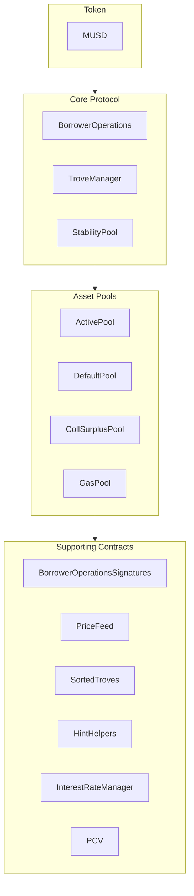

MUSD là một stablecoin được bảo chứng bằng Bitcoin, mang lại một phương tiện lưu trữ giá trị ổn định trong khi vẫn giữ được tính bảo mật và phi tập trung của Bitcoin. Hướng dẫn này trình bày kiến trúc cốt lõi của MUSD và cách tích hợp với các hợp đồng thông minh của nó. MUSD là một vị thế nợ có tài sản thế chấp (CDP) dựa trên [Threshold USD](https://github.com/Threshold-USD/dev), vốn là một bản fork của [Liquity](https://github.com/liquity/dev).

## Tổng quan kiến trúc

Giao thức cho phép người nắm giữ Bitcoin đúc MUSD bằng cách dùng BTC của họ làm tài sản thế chấp. Nhờ vậy, người dùng có thể tiếp cận thanh khoản tính bằng USD mà vẫn giữ nguyên khoản đầu tư Bitcoin của mình. Các thành phần chính là cách hệ thống xử lý **lưu ký**, duy trì **tỷ giá neo** và thu **phí**.

### Lưu ký

Người dùng mở một vị thế bằng cách gọi `BorrowerOperations.openTrove`, cung cấp BTC và yêu cầu MUSD. BTC được chuyển đến `ActivePool` và nằm ở đó cho đến khi người dùng:

- rút ra (qua `BorrowerOperations.withdrawColl`).
- trả hết nợ (qua `BorrowerOperations.closeTrove`).
- bị quy đổi (qua `TroveManager.redeemCollateral`).
- bị thanh lý (qua `TroveManager.liquidate`).

Các vị thế bị thanh lý hoặc được `StabilityPool` chi trả, khi đó BTC được chuyển vào đó, hoặc khoản nợ và tài sản thế chấp được hấp thụ và phân phối lại cho những người dùng khác, khi đó BTC được chuyển vào `DefaultPool`.

### Duy trì tỷ giá neo

Chúng tôi duy trì **mức giá sàn \$1** thông qua hoạt động kinh doanh chênh lệch giá (arbitrage), một oracle giá USD ↔ BTC bên ngoài và khả năng quy đổi MUSD lấy BTC theo tỷ lệ 1:1 (qua `TroveManager.redeemCollateral`). Giả sử MUSD đang được giao dịch ở mức `$0.80` trên một sàn giao dịch và bitcoin đang được bán ở mức `1 BTC = $100k`. Một nhà kinh doanh chênh lệch giá có `$800` có thể:

1. Đổi `$800` lấy `1000 MUSD`.
2. Quy đổi `1000 MUSD` lấy `0.01 BTC` (lượng BTC trị giá `$1000`).
3. Bán `0.01 BTC` lấy `$1000`.

Nhà kinh doanh chênh lệch giá lãi `$200` (chưa tính phí). Giao dịch này **mua** MUSD và **đốt** nó, tạo áp lực đẩy giá lên cho đến khi giá trở về `$1`.

Chúng tôi duy trì **mức giá trần \$1,10** nhờ tỷ lệ thế chấp tối thiểu 110%. Giả sử MUSD đang được giao dịch ở mức `$1.20` trên một sàn giao dịch và bitcoin đang được bán ở mức `1 BTC = $100k`. Một nhà kinh doanh chênh lệch giá có `$100k` có thể:

1. Mua `1 BTC` (trị giá `$100k`).
2. Mở một trove với `1 BTC` làm tài sản thế chấp và vay tối đa `90,909 MUSD`.
3. Bán `90,909 MUSD` lấy `$109,091`.

Nhà kinh doanh chênh lệch giá lãi `$9,091` (chưa tính phí). Giao dịch này **bán** và **đúc** MUSD, tạo áp lực kéo giá xuống cho đến khi giá chạm `$1.10`.

### Phí

Giao thức thu phí ở bốn chỗ:
- Phí vay 0,1% (có thể điều chỉnh qua quản trị), được cộng vào khoản nợ của trove nhưng được đúc cho quản trị.
- Phí quy đổi 0,75% (có thể điều chỉnh qua quản trị), được thu mỗi khi người dùng quy đổi MUSD lấy BTC.
- Phí tái cấp vốn, hoạt động giống như phí vay.
- Lãi đơn, cố định trên tiền gốc của khoản vay.

## Ý tưởng cốt lõi

### Khoản vay khởi động của giao thức và Stability Pool

Khác với các giao thức khuyến khích việc gửi vào stability pool bằng phần thưởng token, Stability Pool của MUSD ban đầu được cấp vốn bằng một khoản vay khởi động. Lượng MUSD này chỉ có thể được dùng cho việc thanh lý. Khi MUSD của giao thức được dùng trong một lần thanh lý, trước tiên nó được dùng để trả số dư khoản vay còn nợ của giao thức, đảm bảo khoản vay khởi động không thể bị rút ra. Các khoản trả nợ cho khoản vay này dự kiến được thực hiện hằng tuần.

### Giá trị do giao thức kiểm soát (PCV)

Theo thời gian, khi giao thức tích lũy lãi và phí, khoản vay khởi động dần được trả hết và phần MUSD trong Stability Pool thuộc về Giá trị do giao thức kiểm soát (Protocol Controlled Value) tăng lên. Hợp đồng PCV quản lý việc phân phối lượng MUSD tích lũy từ lãi và phí, trong đó tỷ lệ phân chia giữa việc trả khoản vay và một người nhận phí có thể được điều chỉnh qua quản trị.

### Tính bất biến và khả năng nâng cấp

Các hợp đồng thông minh của MUSD có thể nâng cấp để cho phép sửa lỗi. Những thay đổi lớn sẽ đòi hỏi triển khai một bộ hợp đồng mới và để người dùng tự chọn tham gia di chuyển, đảm bảo quyền kiểm soát thuộc về người dùng. Khi đã được kiểm chứng qua thực tế, các hợp đồng sẽ được chuyển sang trạng thái bất biến.

## Cấu trúc kho mã

[Kho mã (repository) MUSD](https://github.com/mezo-org/musd.git) bao gồm:

- **[Hợp đồng thông minh](https://github.com/mezo-org/musd/tree/main/contracts)**: Các hợp đồng cốt lõi của giao thức MUSD
- **[Ví dụ tích hợp](https://github.com/mezo-org/musd/tree/main/examples)**: Các bản triển khai mẫu
- **[Bộ kiểm thử](https://github.com/mezo-org/musd/tree/main/test)**: Độ bao phủ kiểm thử toàn diện
- **[Tài liệu](https://github.com/mezo-org/musd/tree/main/docs)**: Đặc tả kỹ thuật

## Thiết lập môi trường phát triển

### Điều kiện tiên quyết

- Node.js 18+ (xem [`.nvmrc`](https://github.com/mezo-org/musd/blob/main/.nvmrc) để biết phiên bản chính xác)
- Trình quản lý gói pnpm
- Foundry để phát triển hợp đồng thông minh
- Git

### Cài đặt

1.  Sao chép (clone) kho mã:
    ```bash
    git clone https://github.com/mezo-org/musd.git
    cd musd
    ```
2.  Cài đặt các gói phụ thuộc:
    ```bash
    pnpm install
    ```
3.  Thiết lập môi trường:
    ```bash
    cp .env.example .env
    # Edit .env with your configuration
    ```

## Tổng quan hệ thống

Hệ thống MUSD gồm bốn nhóm hợp đồng chính:



-   **Giao thức cốt lõi (Core Protocol)**: Xử lý các thao tác chính như mở/đóng vị thế và quản lý tài sản thế chấp.
-   **Pool tài sản (Asset Pools)**: Quản lý các pool tài sản thế chấp và pool thanh khoản của hệ thống.
-   **Hợp đồng hỗ trợ (Supporting Contracts)**: Cung cấp các dịch vụ như nguồn cấp giá, quản lý trove từ xa và PCV.

## Hướng dẫn tích hợp

### Mở một trove

Để tối ưu hiệu quả gas, hãy cung cấp các gợi ý (hint) cho vị trí chèn trove trong danh sách đã sắp xếp.

```typescript
async function openTroveWithHints(
  contracts: {
    borrowerOperations: Contract,
    troveManager: Contract,
    sortedTroves: Contract,
    hintHelpers: Contract
  },
  wallet: Wallet,
  debtAmount: bigint,
  assetAmount: bigint
) {
  // Compute expected total debt by adding gas compensation and fee
  const gasCompensation = await contracts.troveManager.MUSD_GAS_COMPENSATION();
  const expectedFee = 
    await contracts.borrowerOperations.getBorrowingFee(debtAmount);
  const expectedTotalDebt = debtAmount + expectedFee + gasCompensation;

  const nicr = (assetAmount * BigInt(1e20)) / expectedTotalDebt;

  const { '0': approxHint } = await contracts.hintHelpers.getApproxHint(nicr, 15, 42);

  const { '0': upperHint, '1': lowerHint } =
    await contracts.sortedTroves.findInsertPosition(nicr, approxHint, approxHint);

  await contracts.borrowerOperations
    .connect(wallet)
    .openTrove(debtAmount, upperHint, lowerHint, { value: assetAmount });
}
```

### Điều chỉnh và đóng trove

Tương tự, bạn có thể điều chỉnh (`adjustTrove`) hoặc đóng (`closeTrove`) trove. Ngoài ra còn có các hàm tiện ích để rút/trả MUSD và thêm/rút tài sản thế chấp. Để xem ví dụ đầy đủ, hãy tham khảo [tệp kiểm thử demo](https://github.com/mezo-org/musd/blob/main/test/integration/Demo.test.ts).

## Thanh lý

Khi tỷ lệ thế chấp của một trove giảm xuống dưới 110%, bất kỳ ai cũng có thể thanh lý trove đó. Người thanh lý được thưởng một khoản bồi hoàn gas và một tỷ lệ phần trăm tài sản thế chấp của trove.

### Các luồng thanh lý

1.  **Có Stability Pool**: MUSD của Stability Pool bị đốt để bù khoản nợ, và Stability Pool nhận lấy tài sản thế chấp.
2.  **Stability Pool không đủ**: Nếu pool không đủ, pool sẽ bù phần có thể bù, phần nợ/tài sản thế chấp còn lại được phân phối lại cho các trove đang hoạt động khác.
3.  **Stability Pool trống**: Toàn bộ khoản nợ và tài sản thế chấp được phân phối lại cho các trove đang hoạt động khác.

### Thực hiện thanh lý

```typescript
async function liquidateTrove(
  troveManager: Contract,
  wallet: Wallet,
  borrowerAddress: string
) {
  await troveManager.connect(wallet).liquidate(borrowerAddress);
}

async function batchLiquidate(
  troveManager: Contract,
  wallet: Wallet,
  troveAddresses: string[]
) {
  await troveManager.connect(wallet).batchLiquidateTroves(troveAddresses);
}
```

## Quy đổi

Bất kỳ người nắm giữ MUSD nào cũng có thể quy đổi token của mình lấy lượng BTC có giá trị tương đương, giúp duy trì tỷ giá neo `$1`. Hệ thống quy đổi vào trove có tỷ lệ thế chấp thấp nhất.

Để xem hướng dẫn từng bước và mã nguồn, hãy tham khảo hướng dẫn chuyên biệt:

- [Quy đổi MUSD](/docs/vn/docs/developers/musd/musd-redemptions/)

## Rủi ro đối với người vay

-   **Rủi ro bị thanh lý**: Tài sản thế chấp của bạn có thể bị thanh lý nếu giá trị của nó giảm xuống dưới 110% khoản nợ của bạn.
-   **Rủi ro bị quy đổi**: Tài sản thế chấp của bạn có thể bị quy đổi để duy trì tỷ giá neo, phát sinh sự kiện chịu thuế và làm mất khả năng hưởng lợi khi giá tăng.
-   **Nợ xấu**: Trong trường hợp cực đoan, nợ xấu có thể được phân bổ cho những người vay khác.

## Kiểm thử

```bash
# Run all tests
pnpm test

# Run with gas reporting
pnpm test:gas

# Run with coverage
pnpm coverage
```

## Những thay đổi chính so với THUSD

-   **Vay với lãi suất cố định**: Lãi suất được cố định khi mở trove và có thể được tái cấp vốn.
-   **Giá trị do giao thức kiểm soát (PCV)**: Quản lý phí để trả khoản vay và các nhu cầu khác của hệ thống.
-   **Xác minh chữ ký EIP-712**: Cho phép ủy quyền giao dịch không tốn gas.
-   **Không có cơ chế thanh lý đặc biệt trong Recovery Mode**: Việc thanh lý tuân theo một quy trình duy nhất.

## Định nghĩa

-   **Trove**: Một vị thế nợ có tài sản thế chấp (CDP).
-   **ICR**: Tỷ lệ thế chấp riêng (Individual Collateralization Ratio) của một trove.
-   **TCR**: Tỷ lệ thế chấp tổng (Total Collateralization Ratio) của toàn hệ thống.
-   **Recovery Mode**: Được kích hoạt nếu TCR giảm xuống dưới 150%, áp dụng các quy tắc vay nghiêm ngặt hơn.

## Tài nguyên bổ sung

-   **[README chính của MUSD](https://github.com/mezo-org/musd/blob/main/README.md)** - Tổng quan kiến trúc toàn diện.
-   **[Bộ kiểm thử demo](https://github.com/mezo-org/musd/blob/main/test/integration/Demo.test.ts)** - Các ví dụ mã hoạt động được.
-   **[Hướng dẫn sử dụng MUSD](/docs/vn/docs/users/borrow/)** - Tài liệu dành cho người dùng cuối.
