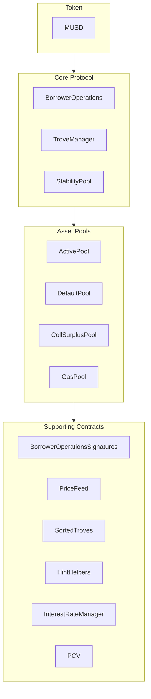

MUSD 是一种由比特币支持的稳定币，在保持比特币安全性和去中心化特性的同时，提供稳定的价值存储。本指南介绍 MUSD 的核心架构以及如何与其智能合约集成。MUSD 是一种基于 [Threshold USD](https://github.com/Threshold-USD/dev) 的抵押债务仓位（CDP），而 Threshold USD 是 [Liquity](https://github.com/liquity/dev) 的分叉。

## 架构概览

该协议允许比特币持有者使用其 BTC 作为抵押品来铸造 MUSD。这意味着用户可以在保留其比特币投资的同时，获得以美元计价的流动性。其主要组成部分是系统如何处理**托管**、维持**价格锚定**以及赚取**费用**。

### 托管

用户通过调用 `BorrowerOperations.openTrove`、提供 BTC 并请求 MUSD 来开立仓位。BTC 会被转入 `ActivePool`，并一直留在那里，直到用户：

- 提取（通过 `BorrowerOperations.withdrawColl`）。
- 还清债务（通过 `BorrowerOperations.closeTrove`）。
- 被赎回（通过 `TroveManager.redeemCollateral`）。
- 被清算（通过 `TroveManager.liquidate`）。

被清算的仓位要么由 `StabilityPool` 偿付（此时 BTC 会转入该池），要么其债务和抵押品被吸收并重新分配给其他用户（此时 BTC 会转入 `DefaultPool`）。

### 维持锚定

我们通过套利、外部 USD ↔ BTC 价格预言机，以及以 1:1 比率将 MUSD 赎回为 BTC 的能力（通过 `TroveManager.redeemCollateral`），来维持 **\$1 的价格下限**。假设 MUSD 在某交易所的交易价格为 `$0.80`，而比特币的售价为 `1 BTC = $100k`。持有 `$800` 的套利者可以：

1. 用 `$800` 换取 `1000 MUSD`。
2. 将 `1000 MUSD` 赎回为 `0.01 BTC`（价值 `$1000` 的 BTC）。
3. 以 `$1000` 卖出 `0.01 BTC`。

套利者获利 `$200`（不计费用）。这笔交易会**买入** MUSD 并将其**销毁**，从而产生价格上行压力，直到价格恢复至 `$1`。

我们通过 110% 的最低抵押率来维持 **\$1.10 的价格上限**。假设 MUSD 在某交易所的交易价格为 `$1.20`，而比特币的售价为 `1 BTC = $100k`。持有 `$100k` 的套利者可以：

1. 买入 `1 BTC`（价值 `$100k`）。
2. 以 `1 BTC` 作为抵押品开立 Trove，并借入最多 `90,909 MUSD`。
3. 以 `$109,091` 卖出 `90,909 MUSD`。

套利者获利 `$9,091`（不计费用）。这笔交易会**卖出**并**铸造** MUSD，从而产生价格下行压力，直到价格降至 `$1.10`。

### 费用

协议在以下四个环节收取费用：
- 0.1% 的借款费率（可由治理调整），该费用作为债务计入 Trove，但铸造给治理方。
- 0.75% 的赎回费率（可由治理调整），每当用户将 MUSD 赎回为 BTC 时收取。
- 再融资费率，其运作方式与借款费率相同。
- 按贷款本金计算的单利固定利息。

## 核心理念

### 协议引导贷款与稳定池

与那些通过代币奖励激励稳定池存款的协议不同，MUSD 的稳定池最初由一笔引导贷款注资。这部分 MUSD 只能用于清算。当协议的 MUSD 被用于清算时，会首先用于偿还协议贷款的未偿余额，从而确保引导贷款无法被提取。预计该贷款将按周偿还。

### 协议控制价值（PCV）

随着时间推移，协议不断累积利息和费用，引导贷款逐步得到偿还，稳定池中属于协议控制价值的 MUSD 比例随之增加。PCV 合约负责管理从利息和费用中累积的 MUSD 的分配，其中用于偿还贷款与分配给费用接收方的比例可由治理调整。

### 不可变性与可升级性

MUSD 智能合约是可升级的，以便进行修复。重大变更需要部署一套新合约，并由用户自愿选择迁移，从而确保用户的控制权。合约在经过实战检验后将被设为不可变。

## 仓库结构

[MUSD 仓库](https://github.com/mezo-org/musd.git)包含：

- **[智能合约](https://github.com/mezo-org/musd/tree/main/contracts)**：MUSD 协议核心合约
- **[集成示例](https://github.com/mezo-org/musd/tree/main/examples)**：示例实现
- **[测试套件](https://github.com/mezo-org/musd/tree/main/test)**：全面的测试覆盖
- **[文档](https://github.com/mezo-org/musd/tree/main/docs)**：技术规范

## 开发环境设置

### 前提条件

- Node.js 18+（具体版本请查看 [`.nvmrc`](https://github.com/mezo-org/musd/blob/main/.nvmrc)）
- pnpm 包管理器
- Foundry（用于智能合约开发）
- Git

### 安装

1.  克隆仓库：
    ```bash
    git clone https://github.com/mezo-org/musd.git
    cd musd
    ```
2.  安装依赖项：
    ```bash
    pnpm install
    ```
3.  设置环境：
    ```bash
    cp .env.example .env
    # Edit .env with your configuration
    ```

## 系统概览

MUSD 系统由四个主要合约组构成：



-   **核心协议（Core Protocol）**：处理开立/关闭仓位、管理抵押品等主要操作。
-   **资产池（Asset Pools）**：管理系统中的各类抵押品池和流动性池。
-   **辅助合约（Supporting Contracts）**：提供价格数据源、远程 Trove 管理和 PCV 等服务。

## 集成指南

### 开立 Trove

为获得最佳 Gas 效率，请为 Trove 在排序列表中的插入位置提供提示（hint）。

```typescript
async function openTroveWithHints(
  contracts: {
    borrowerOperations: Contract,
    troveManager: Contract,
    sortedTroves: Contract,
    hintHelpers: Contract
  },
  wallet: Wallet,
  debtAmount: bigint,
  assetAmount: bigint
) {
  // Compute expected total debt by adding gas compensation and fee
  const gasCompensation = await contracts.troveManager.MUSD_GAS_COMPENSATION();
  const expectedFee = 
    await contracts.borrowerOperations.getBorrowingFee(debtAmount);
  const expectedTotalDebt = debtAmount + expectedFee + gasCompensation;

  const nicr = (assetAmount * BigInt(1e20)) / expectedTotalDebt;

  const { '0': approxHint } = await contracts.hintHelpers.getApproxHint(nicr, 15, 42);

  const { '0': upperHint, '1': lowerHint } =
    await contracts.sortedTroves.findInsertPosition(nicr, approxHint, approxHint);

  await contracts.borrowerOperations
    .connect(wallet)
    .openTrove(debtAmount, upperHint, lowerHint, { value: assetAmount });
}
```

### 调整和关闭 Trove

您可以用类似的方式调整（`adjustTrove`）或关闭（`closeTrove`）Trove。此外还提供了便捷函数，用于提取/偿还 MUSD 以及添加/提取抵押品。完整示例请参阅[演示测试文件](https://github.com/mezo-org/musd/blob/main/test/integration/Demo.test.ts)。

## 清算

当 Trove 的抵押率低于 110% 时，任何人都可以对其进行清算。清算人将获得 Gas 补偿以及该 Trove 一定比例的抵押品作为奖励。

### 清算流程

1.  **使用稳定池**：销毁稳定池中的 MUSD 以覆盖债务，稳定池则获得该抵押品。
2.  **稳定池部分覆盖**：如果稳定池资金不足，则由其覆盖力所能及的部分，剩余的债务/抵押品重新分配给其他活跃的 Trove。
3.  **稳定池为空**：所有债务和抵押品都重新分配给其他活跃的 Trove。

### 执行清算

```typescript
async function liquidateTrove(
  troveManager: Contract,
  wallet: Wallet,
  borrowerAddress: string
) {
  await troveManager.connect(wallet).liquidate(borrowerAddress);
}

async function batchLiquidate(
  troveManager: Contract,
  wallet: Wallet,
  troveAddresses: string[]
) {
  await troveManager.connect(wallet).batchLiquidateTroves(troveAddresses);
}
```

## 赎回

任何 MUSD 持有者都可以将其代币赎回为等值的 BTC，这有助于维持 `$1` 的锚定。系统会针对抵押率最低的 Trove 进行赎回。

有关分步说明和代码，请参阅专门的指南：

- [MUSD 赎回](/docs/zh/docs/developers/musd/musd-redemptions/)

## 借款人风险

-   **清算风险**：如果您的抵押品价值低于债务的 110%，您的抵押品可能会被清算。
-   **赎回风险**：为维持锚定，您的抵押品可能会被赎回，从而引发应税事件，并使您失去上涨敞口。
-   **坏账**：在极端情况下，坏账可能会由其他借款人共同分摊。

## 测试

```bash
# Run all tests
pnpm test

# Run with gas reporting
pnpm test:gas

# Run with coverage
pnpm coverage
```

## 相对于 THUSD 的主要变更

-   **固定利率借款**：利率在开立 Trove 时确定，并可通过再融资调整。
-   **协议控制价值（PCV）**：管理用于偿还贷款和满足其他系统需求的费用。
-   **EIP-712 签名验证**：支持无需 Gas 的交易授权。
-   **无特殊的恢复模式清算**：清算遵循单一流程。

## 定义

-   **Trove**：抵押债务仓位（CDP）。
-   **ICR**：单个 Trove 的个人抵押率。
-   **TCR**：整个系统的系统总抵押率。
-   **恢复模式（Recovery Mode）**：当 TCR 低于 150% 时激活，并执行更严格的借款规则。

## 其他资源

-   **[MUSD 主 README](https://github.com/mezo-org/musd/blob/main/README.md)** - 全面的架构概览。
-   **[演示测试套件](https://github.com/mezo-org/musd/blob/main/test/integration/Demo.test.ts)** - 可运行的代码示例。
-   **[MUSD 用户指南](/docs/zh/docs/users/borrow/)** - 面向终端用户的文档。
